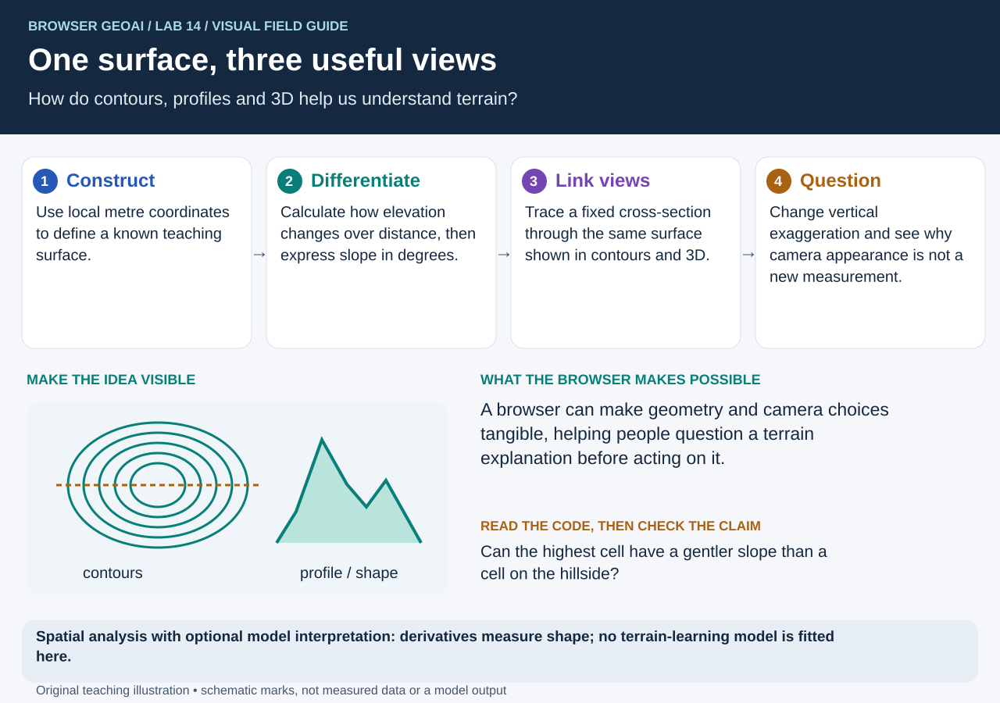

# JupyterLite + GeoLibre + GeoAI

Browser-native geospatial notebooks that combine **[GeoLibre](https://geolibre.app/)**, open geospatial data, and **GeoAI workflows** in **JupyterLite**.

[](https://github.com/jltobias/JupyterLite-GeoLibre-GeoAI/actions/workflows/pages.yml)
[](https://geolibre.app/)
[](https://opengeoai.org/)

**GeoLibre citation:** Wu, Q. (2026). *GeoLibre: A lightweight, cloud-native GIS platform for visualizing, exploring, and analyzing geospatial data.* Zenodo. [https://doi.org/10.5281/zenodo.20785400](https://doi.org/10.5281/zenodo.20785400)

**GeoAI citation:** Wu, Q. (2026). *GeoAI: A Python package for integrating artificial intelligence with geospatial data analysis and visualization.* *Journal of Open Source Software*, 11(118), 9605. [https://doi.org/10.21105/joss.09605](https://doi.org/10.21105/joss.09605).

## Live sites

- **Jupyter Book:** <https://jltobias.github.io/JupyterLite-GeoLibre-GeoAI/>  
- **JupyterLite Lab:** <https://jltobias.github.io/JupyterLite-GeoLibre-GeoAI/lite/lab/index.html>

## Launch the notebooks

Start with [What is JupyterLite?](https://jltobias.github.io/JupyterLite-GeoLibre-GeoAI/platforms/jupyterlite.html) and [What is GeoLibre?](https://jltobias.github.io/JupyterLite-GeoLibre-GeoAI/platforms/geolibre.html). These beginner chapters use **seven unchanged graphics from James L. Tobias's July 10, 2026 presentation**, with reading guides, practical exercises, figure-level credits and an image provenance manifest. They explain the browser runtime, saving versus publishing, GeoLibre's notebook integrations and this repository's `LiteMap` boundary. GeoLibre receives its official Qiusheng Wu / Zenodo citation; original software and basemap credits are retained.

New: the [GeoAI visual field guide](https://jltobias.github.io/JupyterLite-GeoLibre-GeoAI/geoai/primer.html) adds **seven chapters and 24 original infographics**. It explains GeoAI versus general AI/GIS, how models work, and what all 18 notebooks actually demonstrate. Program chapters cover PEPFAR/HIV/TB, polio, malaria, Ebola, emergency response, heat, coastal floods, food/water insecurity, air/water quality, vector shifts, migration and conflict. Every application separates a potential benefit from the data, validation and governance needed to establish it.

The diagrams are accessible, locally bundled SVGs with plain-language reading guides. They complement the existing notebook videos and cartoons, preserve the supplied Six Thinking Hats artwork, and cite authoritative sources. Rebuild with `python scripts/build_geoai_primer.py`; check the committed assets with `python scripts/build_geoai_primer.py --check`. No image service or external package is needed to regenerate them.

## Explore maps, scenes and visual stories

[Open the visual resource guide](https://jltobias.github.io/JupyterLite-GeoLibre-GeoAI/visual-library.html) for explanations of what each view represents and what requires running Python.

| Resource | Live destination | Read the evidence correctly |
|---|---|---|
| 2D maps | [Quickstart](https://jltobias.github.io/JupyterLite-GeoLibre-GeoAI/notebooks/00_geolibre_quickstart.html) · [STAC footprints](https://jltobias.github.io/JupyterLite-GeoLibre-GeoAI/notebooks/08_stac_geoai_footprints.html) | Run the notebook for live GeoLibre layers |
| 3D maps and scenes | [Terrain lab 14](https://jltobias.github.io/JupyterLite-GeoLibre-GeoAI/notebooks/14_astra_terrain_3d.html) | Rotatable synthetic terrain; native GeoLibre extrusions when run |
| Story-led evidence | [Report lab 16](https://jltobias.github.io/JupyterLite-GeoLibre-GeoAI/notebooks/16_sea_level_rise_sat_scan_geoai.html) | Narrative notebook with independent 2D/3D views, not an exported GeoLibre story-map app |
| Time-series and change | [Rainfall lab 04](https://jltobias.github.io/JupyterLite-GeoLibre-GeoAI/notebooks/04_chirps_climate.html) · [Image-change lab 13](https://jltobias.github.io/JupyterLite-GeoLibre-GeoAI/notebooks/13_astra_vision_change.html) | Synthetic chart and image pair; an observed time-series **map** is not yet implemented |
| Scenario animation | [Report A/B/C comparison](https://jltobias.github.io/JupyterLite-GeoLibre-GeoAI/notebooks/16_sea_level_rise_sat_scan_geoai.html) | Report indicators, not dates, water depths or a flood simulation |
| Short videos and cartoons | [All 18 captioned companions](https://jltobias.github.io/JupyterLite-GeoLibre-GeoAI/lite/files/assets/learning/index.html) | Silent teaching storyboards with transcripts and downloadable MP4s |
| Infographics and sense-making | [GeoAI field guide](https://jltobias.github.io/JupyterLite-GeoLibre-GeoAI/geoai/primer.html) · [Thinking hats](https://jltobias.github.io/JupyterLite-GeoLibre-GeoAI/notebooks/17_rewiring_global_health_six_hats.html) | Separate computations, assumptions and possible global-health applications |

[](https://jltobias.github.io/JupyterLite-GeoLibre-GeoAI/notebooks/14_astra_terrain_3d.html)

**Upstream inspiration:** [GeoLibre gallery](https://geolibre.app/gallery/), [story-map authoring](https://geolibre.app/user-guide/storymaps/) and [video tutorials](https://geolibre.app/tutorials/videos/), by **Qiusheng Wu and contributors**. These are separate upstream resources; individual demo creators and data providers retain their credits. Read the [GeoLibre creator, related work and citation](https://jltobias.github.io/JupyterLite-GeoLibre-GeoAI/platforms/geolibre.html#how-to-cite-geolibre-and-these-figures).

## Read, run or watch any notebook

**New conceptual chapters:** [Digital twins and agent-based simulation](https://jltobias.github.io/JupyterLite-GeoLibre-GeoAI/futures/digital-twins.html) and [Map encryption and geoprivacy](https://jltobias.github.io/JupyterLite-GeoLibre-GeoAI/futures/map-encryption.html). Informed by the supplied Gaborone TB and Map Encryption presentations, these sections add four original diagrams/cartoons, source-page attributions and links to related labs. They describe potential extensions, not deployed disease forecasting or cryptographic services.

**Read** opens the Book; **Run** opens JupyterLite; **Watch** opens the captioned companion. The last two links open full-size graphics.

<!-- BEGIN NOTEBOOK RESOURCES -->

| Notebook | Read / run | Visual companions |
|---|---|---|
| 00 — A map is a data recipe | [Read](https://jltobias.github.io/JupyterLite-GeoLibre-GeoAI/notebooks/00_geolibre_quickstart.html) · [Run](https://jltobias.github.io/JupyterLite-GeoLibre-GeoAI/lite/lab/index.html?path=00_geolibre_quickstart.ipynb) | [Watch](https://jltobias.github.io/JupyterLite-GeoLibre-GeoAI/lite/files/assets/learning/00/watch.html) · [Infographic](https://jltobias.github.io/JupyterLite-GeoLibre-GeoAI/lite/files/assets/learning/00/infographic.svg) · [Cartoon](https://jltobias.github.io/JupyterLite-GeoLibre-GeoAI/lite/files/assets/learning/00/cartoon.svg) |
| 01 — The hexagon is a container | [Read](https://jltobias.github.io/JupyterLite-GeoLibre-GeoAI/notebooks/01_worldpop_h3.html) · [Run](https://jltobias.github.io/JupyterLite-GeoLibre-GeoAI/lite/lab/index.html?path=01_worldpop_h3.ipynb) | [Watch](https://jltobias.github.io/JupyterLite-GeoLibre-GeoAI/lite/files/assets/learning/01/watch.html) · [Infographic](https://jltobias.github.io/JupyterLite-GeoLibre-GeoAI/lite/files/assets/learning/01/infographic.svg) · [Cartoon](https://jltobias.github.io/JupyterLite-GeoLibre-GeoAI/lite/files/assets/learning/01/cartoon.svg) |
| 02 — From county rows to patterns | [Read](https://jltobias.github.io/JupyterLite-GeoLibre-GeoAI/notebooks/02_census_geoai_counties.html) · [Run](https://jltobias.github.io/JupyterLite-GeoLibre-GeoAI/lite/lab/index.html?path=02_census_geoai_counties.ipynb) | [Watch](https://jltobias.github.io/JupyterLite-GeoLibre-GeoAI/lite/files/assets/learning/02/watch.html) · [Infographic](https://jltobias.github.io/JupyterLite-GeoLibre-GeoAI/lite/files/assets/learning/02/infographic.svg) · [Cartoon](https://jltobias.github.io/JupyterLite-GeoLibre-GeoAI/lite/files/assets/learning/02/cartoon.svg) |
| 03 — Pixels become model features | [Read](https://jltobias.github.io/JupyterLite-GeoLibre-GeoAI/notebooks/03_earth_observation_geoai.html) · [Run](https://jltobias.github.io/JupyterLite-GeoLibre-GeoAI/lite/lab/index.html?path=03_earth_observation_geoai.ipynb) | [Watch](https://jltobias.github.io/JupyterLite-GeoLibre-GeoAI/lite/files/assets/learning/03/watch.html) · [Infographic](https://jltobias.github.io/JupyterLite-GeoLibre-GeoAI/lite/files/assets/learning/03/infographic.svg) · [Cartoon](https://jltobias.github.io/JupyterLite-GeoLibre-GeoAI/lite/files/assets/learning/03/cartoon.svg) |
| 04 — A day is not a climate trend | [Read](https://jltobias.github.io/JupyterLite-GeoLibre-GeoAI/notebooks/04_chirps_climate.html) · [Run](https://jltobias.github.io/JupyterLite-GeoLibre-GeoAI/lite/lab/index.html?path=04_chirps_climate.ipynb) | [Watch](https://jltobias.github.io/JupyterLite-GeoLibre-GeoAI/lite/files/assets/learning/04/watch.html) · [Infographic](https://jltobias.github.io/JupyterLite-GeoLibre-GeoAI/lite/files/assets/learning/04/infographic.svg) · [Cartoon](https://jltobias.github.io/JupyterLite-GeoLibre-GeoAI/lite/files/assets/learning/04/cartoon.svg) |
| 05 — Unusual is a question to investigate | [Read](https://jltobias.github.io/JupyterLite-GeoLibre-GeoAI/notebooks/05_h3_earthquake_geoai.html) · [Run](https://jltobias.github.io/JupyterLite-GeoLibre-GeoAI/lite/lab/index.html?path=05_h3_earthquake_geoai.ipynb) | [Watch](https://jltobias.github.io/JupyterLite-GeoLibre-GeoAI/lite/files/assets/learning/05/watch.html) · [Infographic](https://jltobias.github.io/JupyterLite-GeoLibre-GeoAI/lite/files/assets/learning/05/infographic.svg) · [Cartoon](https://jltobias.github.io/JupyterLite-GeoLibre-GeoAI/lite/files/assets/learning/05/cartoon.svg) |
| 06 — Follow the runtime handoff | [Read](https://jltobias.github.io/JupyterLite-GeoLibre-GeoAI/notebooks/06_geoai_compatibility.html) · [Run](https://jltobias.github.io/JupyterLite-GeoLibre-GeoAI/lite/lab/index.html?path=06_geoai_compatibility.ipynb) | [Watch](https://jltobias.github.io/JupyterLite-GeoLibre-GeoAI/lite/files/assets/learning/06/watch.html) · [Infographic](https://jltobias.github.io/JupyterLite-GeoLibre-GeoAI/lite/files/assets/learning/06/infographic.svg) · [Cartoon](https://jltobias.github.io/JupyterLite-GeoLibre-GeoAI/lite/files/assets/learning/06/cartoon.svg) |
| 07 — Read the catalog before the pixels | [Read](https://jltobias.github.io/JupyterLite-GeoLibre-GeoAI/notebooks/07_stac_browser_catalogs.html) · [Run](https://jltobias.github.io/JupyterLite-GeoLibre-GeoAI/lite/lab/index.html?path=07_stac_browser_catalogs.ipynb) | [Watch](https://jltobias.github.io/JupyterLite-GeoLibre-GeoAI/lite/files/assets/learning/07/watch.html) · [Infographic](https://jltobias.github.io/JupyterLite-GeoLibre-GeoAI/lite/files/assets/learning/07/infographic.svg) · [Cartoon](https://jltobias.github.io/JupyterLite-GeoLibre-GeoAI/lite/files/assets/learning/07/cartoon.svg) |
| 08 — A footprint is not its contents | [Read](https://jltobias.github.io/JupyterLite-GeoLibre-GeoAI/notebooks/08_stac_geoai_footprints.html) · [Run](https://jltobias.github.io/JupyterLite-GeoLibre-GeoAI/lite/lab/index.html?path=08_stac_geoai_footprints.ipynb) | [Watch](https://jltobias.github.io/JupyterLite-GeoLibre-GeoAI/lite/files/assets/learning/08/watch.html) · [Infographic](https://jltobias.github.io/JupyterLite-GeoLibre-GeoAI/lite/files/assets/learning/08/infographic.svg) · [Cartoon](https://jltobias.github.io/JupyterLite-GeoLibre-GeoAI/lite/files/assets/learning/08/cartoon.svg) |
| 09 — A transparent discovery assistant | [Read](https://jltobias.github.io/JupyterLite-GeoLibre-GeoAI/notebooks/09_geolibre_demo_recommender.html) · [Run](https://jltobias.github.io/JupyterLite-GeoLibre-GeoAI/lite/lab/index.html?path=09_geolibre_demo_recommender.ipynb) | [Watch](https://jltobias.github.io/JupyterLite-GeoLibre-GeoAI/lite/files/assets/learning/09/watch.html) · [Infographic](https://jltobias.github.io/JupyterLite-GeoLibre-GeoAI/lite/files/assets/learning/09/infographic.svg) · [Cartoon](https://jltobias.github.io/JupyterLite-GeoLibre-GeoAI/lite/files/assets/learning/09/cartoon.svg) |
| 10 — Geography plus relationships | [Read](https://jltobias.github.io/JupyterLite-GeoLibre-GeoAI/notebooks/10_sister_cities_graph_geoai.html) · [Run](https://jltobias.github.io/JupyterLite-GeoLibre-GeoAI/lite/lab/index.html?path=10_sister_cities_graph_geoai.ipynb) | [Watch](https://jltobias.github.io/JupyterLite-GeoLibre-GeoAI/lite/files/assets/learning/10/watch.html) · [Infographic](https://jltobias.github.io/JupyterLite-GeoLibre-GeoAI/lite/files/assets/learning/10/infographic.svg) · [Cartoon](https://jltobias.github.io/JupyterLite-GeoLibre-GeoAI/lite/files/assets/learning/10/cartoon.svg) |
| 11 — From a fire shape to a scene shortlist | [Read](https://jltobias.github.io/JupyterLite-GeoLibre-GeoAI/notebooks/11_wildfire_stac_triage.html) · [Run](https://jltobias.github.io/JupyterLite-GeoLibre-GeoAI/lite/lab/index.html?path=11_wildfire_stac_triage.ipynb) | [Watch](https://jltobias.github.io/JupyterLite-GeoLibre-GeoAI/lite/files/assets/learning/11/watch.html) · [Infographic](https://jltobias.github.io/JupyterLite-GeoLibre-GeoAI/lite/files/assets/learning/11/infographic.svg) · [Cartoon](https://jltobias.github.io/JupyterLite-GeoLibre-GeoAI/lite/files/assets/learning/11/cartoon.svg) |
| 12 — A question becomes a checked operation | [Read](https://jltobias.github.io/JupyterLite-GeoLibre-GeoAI/notebooks/12_astra_spatial_copilot.html) · [Run](https://jltobias.github.io/JupyterLite-GeoLibre-GeoAI/lite/lab/index.html?path=12_astra_spatial_copilot.ipynb) | [Watch](https://jltobias.github.io/JupyterLite-GeoLibre-GeoAI/lite/files/assets/learning/12/watch.html) · [Infographic](https://jltobias.github.io/JupyterLite-GeoLibre-GeoAI/lite/files/assets/learning/12/infographic.svg) · [Cartoon](https://jltobias.github.io/JupyterLite-GeoLibre-GeoAI/lite/files/assets/learning/12/cartoon.svg) |
| 13 — Measure change before explaining it | [Read](https://jltobias.github.io/JupyterLite-GeoLibre-GeoAI/notebooks/13_astra_vision_change.html) · [Run](https://jltobias.github.io/JupyterLite-GeoLibre-GeoAI/lite/lab/index.html?path=13_astra_vision_change.ipynb) | [Watch](https://jltobias.github.io/JupyterLite-GeoLibre-GeoAI/lite/files/assets/learning/13/watch.html) · [Infographic](https://jltobias.github.io/JupyterLite-GeoLibre-GeoAI/lite/files/assets/learning/13/infographic.svg) · [Cartoon](https://jltobias.github.io/JupyterLite-GeoLibre-GeoAI/lite/files/assets/learning/13/cartoon.svg) |
| 14 — One surface, three useful views | [Read](https://jltobias.github.io/JupyterLite-GeoLibre-GeoAI/notebooks/14_astra_terrain_3d.html) · [Run](https://jltobias.github.io/JupyterLite-GeoLibre-GeoAI/lite/lab/index.html?path=14_astra_terrain_3d.ipynb) | [Watch](https://jltobias.github.io/JupyterLite-GeoLibre-GeoAI/lite/files/assets/learning/14/watch.html) · [Infographic](https://jltobias.github.io/JupyterLite-GeoLibre-GeoAI/lite/files/assets/learning/14/infographic.svg) · [Cartoon](https://jltobias.github.io/JupyterLite-GeoLibre-GeoAI/lite/files/assets/learning/14/cartoon.svg) |
| 15 — A bridge changes the reachable world | [Read](https://jltobias.github.io/JupyterLite-GeoLibre-GeoAI/notebooks/15_astra_network_accessibility.html) · [Run](https://jltobias.github.io/JupyterLite-GeoLibre-GeoAI/lite/lab/index.html?path=15_astra_network_accessibility.ipynb) | [Watch](https://jltobias.github.io/JupyterLite-GeoLibre-GeoAI/lite/files/assets/learning/15/watch.html) · [Infographic](https://jltobias.github.io/JupyterLite-GeoLibre-GeoAI/lite/files/assets/learning/15/infographic.svg) · [Cartoon](https://jltobias.github.io/JupyterLite-GeoLibre-GeoAI/lite/files/assets/learning/15/cartoon.svg) |
| 16 — Keep the risk axes honest | [Read](https://jltobias.github.io/JupyterLite-GeoLibre-GeoAI/notebooks/16_sea_level_rise_sat_scan_geoai.html) · [Run](https://jltobias.github.io/JupyterLite-GeoLibre-GeoAI/lite/lab/index.html?path=16_sea_level_rise_sat_scan_geoai.ipynb) | [Watch](https://jltobias.github.io/JupyterLite-GeoLibre-GeoAI/lite/files/assets/learning/16/watch.html) · [Infographic](https://jltobias.github.io/JupyterLite-GeoLibre-GeoAI/lite/files/assets/learning/16/infographic.svg) · [Cartoon](https://jltobias.github.io/JupyterLite-GeoLibre-GeoAI/lite/files/assets/learning/16/cartoon.svg) |
| 17 — More perspectives, accountable decisions | [Read](https://jltobias.github.io/JupyterLite-GeoLibre-GeoAI/notebooks/17_rewiring_global_health_six_hats.html) · [Run](https://jltobias.github.io/JupyterLite-GeoLibre-GeoAI/lite/lab/index.html?path=17_rewiring_global_health_six_hats.ipynb) | [Watch](https://jltobias.github.io/JupyterLite-GeoLibre-GeoAI/lite/files/assets/learning/17/watch.html) · [Infographic](https://jltobias.github.io/JupyterLite-GeoLibre-GeoAI/lite/files/assets/learning/17/infographic.svg) · [Cartoon](https://jltobias.github.io/JupyterLite-GeoLibre-GeoAI/lite/files/assets/learning/17/cartoon.svg) |

<!-- END NOTEBOOK RESOURCES -->

All 18 notebooks include an original infographic, a three-panel teaching cartoon, a 32-second captioned video with a transcript, and an explanation before every code cell. The **predict → run → compare → explain** exercises connect Python syntax to geographic meaning. Start with the [beginner's guide](https://jltobias.github.io/JupyterLite-GeoLibre-GeoAI/learning-guide.html) or browse the [visual learning library](https://jltobias.github.io/JupyterLite-GeoLibre-GeoAI/lite/files/assets/learning/index.html).

The media is bundled in `book/notebooks/assets/learning/`; videos have player controls, English captions and text alternatives, with no third-party video embeds. Original schematic graphics illustrate methods; analytical plots retain their data-source citations. The guides distinguish browser machine learning from spatial preparation, deterministic rules, existing statistical results and optional external model calls.

Start with **00 → 01 → 02** for spatial representations, **03 → 13** for imagery, **14** for terrain, or **12 → 15** for Astra-assisted analysis. Labs 12–15 have saved static figure outputs and deterministic synthetic datasets. Their analytical exercises do not depend on changing data APIs. Synthetic values are explicitly labeled; they are not measurements of the displayed real-world locations. GeoLibre's hosted viewer, basemaps, initial package installation, and interactive Plotly scripts still need internet access. Native map widgets appear when the notebook runs.

## Using GPT-6 Astra

The new labs use Astra's documented image inputs, structured outputs, and function calling to propose bounded operations and interpret supplied evidence. They do not claim a dedicated GIS engine or geospatial accuracy benchmark. Python computes the measurements, GeoLibre displays the geometry, and a full GeoAI runtime can supply heavier inference. See the [Astra model](https://developers.openai.com/api/docs/models/gpt-6-astra) and [Responses function-calling documentation](https://developers.openai.com/api/docs/guides/function-calling).

In labs 12–15, the default **Run All makes no external model API calls**. Offline plans/tool arguments are hand-authored teaching examples, not claimed model outputs. Each of these four labs exports a Responses API request to `exports/`. To try Astra:

1. Download a request JSON from JupyterLite. For lab 15 also download `accessibility_evidence.json`.
2. Set `OPENAI_API_KEY` in a full CPython terminal outside JupyterLite. Never embed the key in browser code, a notebook, or a deployed static site.
3. Preview or send the request from the repo root:

   ```bash
   python scripts/run_astra.py spatial_plan_request.json
   python scripts/run_astra.py spatial_plan_request.json --send --output astra_response.json
   python scripts/run_astra.py accessibility_request.json --evidence accessibility_evidence.json --send --output astra_response.json
   ```

4. Upload the response JSON into the notebook folder, set `RESPONSE_PATH`, and rerun the import cell. Review the answer against the computed evidence.

Sending uses your API project's access and billing. The runner reports token usage, rejects incomplete/refused responses, and bounds the accessibility tool loop. No API SDK, API key, or server is required for the default teaching run. Live API access is separate from access to Astra in a chat application.

## Why this architecture?

### GeoLibre in JupyterLite

The upstream `geolibre.Map` widget is designed for normal Jupyter kernels. It starts a loopback HTTP server to serve GeoLibre's bundled application. A standalone JupyterLite kernel runs inside Pyodide/WebAssembly and cannot bind a TCP socket, so directly constructing `geolibre.Map()` raises an `OSError` in the browser.

The live notebooks therefore install `geolibre==3.0.0` but use **`book/notebooks/geolibre_lite.py`**. `LiteMap` is a small `anywidget` adapter that:

1. uses GeoLibre's own Python project and layer builders;
2. preserves GeoLibre project/layer schemas for GeoJSON, COG, PMTiles and graduated symbology;
3. displays the project with GeoLibre's upstream hosted viewer (`https://web.geolibre.app/?embed=1`);
4. uses the same `postMessage` project-loading protocol as GeoLibre's standalone HTML export; and
5. never opens a localhost server or OS socket.

In regular JupyterLab, VS Code, JupyterHub, Binder, or another full CPython environment where the kernel-side server/proxy is available, use upstream `geolibre.Map` directly.

### GeoAI in JupyterLite

The current `geoai-py` package includes PyTorch, TorchGeo, Transformers, rasterio, OpenCV, and other dependencies. Pyodide provides an unusually capable browser geospatial/scientific stack—including GeoPandas, rasterio, H3, scikit-learn, and scikit-image—but not the full PyTorch/TorchGeo stack. Therefore these examples implement **GeoAI-style data preparation, feature engineering, unsupervised learning, anomaly detection, and raster classification directly in JupyterLite**, then provide a clear continuation path to the full GeoAI package for GPU/deep-learning workflows.

## Build locally

```bash
python -m pip install -r requirements.txt
rm -rf site book/_build
python scripts/build_lite.py
jupyter-book build book
cp -a book/_build/html/. site/
touch site/.nojekyll
python -m http.server -d site 8000
```

Open <http://localhost:8000> for the book or <http://localhost:8000/lite/lab/index.html> for JupyterLite.

`scripts/build_lite.py` explicitly includes the Pyodide kernel, Jupyter widget manager and anywidget extensions, including when Python packages were installed with `pip --user`. It verifies those extensions in the built site. Saved figures are generated in CPython; running the notebooks in JupyterLite creates fresh browser results.

## Verify the learning labs

```bash
python -m pip install -r requirements-test.txt
python -m unittest discover -s tests -v
python scripts/validate_notebooks.py --execute
```

Validation checks all notebook schemas and Python syntax, then executes labs 12–17 in isolated temporary directories without data-service or external model API calls. Labs 16–17 use the bundled CSV and are not relabeled as synthetic. Use `--execute --save-outputs` to refresh saved figures and tables, then `python scripts/build_learning_media.py` to normalize generated notebook content. Older notebooks still query their documented public data services; CORS, availability and changing feeds must be checked in the browser. The book build intentionally does not execute those live queries.

After assembling `site/`, run `python scripts/check_site_alignment.py` to compare all Book notebook downloads and Lite content files with their canonical sources and check README resource targets. The deployment runs this guard and browser playback/caption checks for all 18 videos. See [the repository review](REPO_REVIEW.md) for remaining analytical and verification gaps.

## Maintain the teaching materials

Authored copy lives in `scripts/learning_content.py`. `scripts/build_learning_media.py` checks each explanation against its code-cell anchor, preserves executable code and outputs, and replaces only its marked teaching cells.

```bash
python scripts/build_learning_media.py --check
python scripts/build_resource_index.py --check
python scripts/build_future_chapters.py --check
# To edit/rebuild the learning edition:
python scripts/build_learning_media.py
python scripts/build_resource_index.py
# Optional, when changing video content:
python -m pip install -r requirements-media.txt
python -m playwright install chromium
python scripts/build_learning_media.py --videos
```

Committed MP4/PNG/SVG/HTML/VTT assets are used directly by the site build; rendering tools are not installed into notebook kernels. Publish the book together with `site/lite` so the video companion links resolve. The first JupyterLite setup and live data still need network access; downloaded video files and their transcripts can be used offline.

## Citations, attribution, and licenses

Presentation graphics in `book/assets/platforms/` are separate from the repository's original teaching diagrams. Their [provenance manifest](book/assets/platforms/provenance.json) identifies seven source images and both supplied source-file hashes; the chapters carry the visible captions. The original PDF/PPTX is not required to build the site and is not committed. Check integrity with `python scripts/extract_platform_graphics.py --check`. To reproduce extraction from the supplied originals, run `python scripts/extract_platform_graphics.py --pptx PATH_TO_ORIGINAL.pptx --pdf PATH_TO_ORIGINAL.pdf`. The script checks slide/image relationships and copies PNG bytes without re-encoding; it does not create a new license for the source artwork.

Every notebook contains a **Data & software citations** section. The table below makes the repository-level attributions self-contained; **[DATA_SOURCES.md](DATA_SOURCES.md)** remains the detailed provenance register with fixed asset URLs, roles, caveats, and product-specific notes.

When publishing results derived from these notebooks, cite the original data producer—not only this repository, GeoLibre, a catalog, or a hosting mirror. A catalog or mirror does not replace the source product's terms. Recheck the linked collection metadata before redistribution because upstream terms and versions can change.

### Core software

- **GeoLibre:** Wu, Q. (2026). *GeoLibre: A lightweight, cloud-native GIS platform for visualizing, exploring, and analyzing geospatial data.* Zenodo. https://doi.org/10.5281/zenodo.20785400. Source: https://github.com/opengeos/GeoLibre. License: MIT.
- **GeoAI:** Wu, Q. (2026). “GeoAI: A Python package for integrating artificial intelligence with geospatial data analysis and visualization.” *Journal of Open Source Software*, 11(118), 9605. https://doi.org/10.21105/joss.09605. Source: https://github.com/opengeos/geoai. License: MIT.
- **JupyterLite / Pyodide:** https://jupyterlite.readthedocs.io/ and https://pyodide.org/. Retain the licenses and notices of the individual packages loaded into Pyodide.
- **Uber H3:** https://h3geo.org/ and https://github.com/uber/h3-py. License: Apache-2.0.
- **scikit-learn:** Pedregosa et al. (2011), “Scikit-learn: Machine Learning in Python,” *Journal of Machine Learning Research*, 12, 2825–2830. https://jmlr.org/papers/v12/pedregosa11a.html. License: BSD-3-Clause.
- **NetworkX:** Hagberg, A., Swart, P., & Schult, D. (2008). *Exploring network structure, dynamics, and function using NetworkX.* https://networkx.org/. License: BSD-3-Clause.

### Data and service attribution by lab

| Labs | Data/service | Required attribution and terms |
|---|---|---|
| 00 | GeoLibre sample places and public DEM | GeoLibre sample: `https://assets.geolibre.app/data/places.geojson`. DEM hosted in the `giswqs/opengeos` collection on [Source Cooperative](https://source.coop/giswqs/opengeos). Verify the asset-level terms before redistribution. |
| 01 | WorldPop 2020 population counts | Bondarenko, M., Kerr, D., Sorichetta, A., & Tatem, A.J. (2020). *Census/projection-disaggregated gridded population datasets for 189 countries in 2020 using BSGM outputs.* WorldPop, University of Southampton. https://doi.org/10.5258/SOTON/WP00684. The cited product family is CC BY 4.0; verify substituted layers independently. |
| 02 | U.S. Census Bureau Census 2020 / TIGERweb | Source: U.S. Census Bureau, [TIGERweb State and County service](https://tigerweb.geo.census.gov/arcgis/rest/services/TIGERweb/State_County/MapServer). U.S. Census Bureau data are used with source identification; consult Census terms for a substituted service or product. |
| 03 | Major TOM, Copernicus Sentinel-2, Copernicus DEM GLO-30, ESA WorldCover | [Major TOM Core](https://source.coop/major-tom/core) supplies aligned cloud assets. Attribute the underlying Copernicus Sentinel-2, Copernicus DEM, and ESA WorldCover products and follow each source's terms listed by the collection. Major TOM/Source Cooperative hosting does not replace those terms. |
| 03 | NASA GIBS imagery | Imagery served by [NASA Global Imagery Browse Services](https://www.earthdata.nasa.gov/data/tools/gibs). Attribute NASA and the specific instrument/product shown by the notebook; consult the product metadata for science use. |
| 04 | CHIRPS v3 daily precipitation | Climate Hazards Center CHIRPS3 Data Repository (2025), https://doi.org/10.15780/G2JQ0P. WFP/VAM [CHIRPS v3 RNL daily mirror](https://source.coop/wfp/chirps-rnl-daily), CC BY 4.0. **CHIRPS is produced by the Climate Hazards Center at UC Santa Barbara, not NOAA.** |
| 05 | USGS Earthquake Hazards Program | Source: U.S. Geological Survey, [Earthquake Hazards Program GeoJSON feeds](https://earthquake.usgs.gov/earthquakes/feed/v1.0/geojson.php). Record the retrieval time because the monthly feed is live. Do not interpret the anomaly model as earthquake prediction or official hazard guidance. |
| 06 | National Land Cover Database | Source: U.S. Geological Survey, [Annual National Land Cover Database](https://www.usgs.gov/centers/eros/science/annual-national-land-cover-database). The example COG is hosted on Source Cooperative; attribute USGS and the specific NLCD product/year. |
| 07–08 | STAC specification and public catalogs | Cite the [STAC specification](https://stacspec.org/) and the data collection actually used. Catalogs demonstrated: [UN Biodiversity Lab](https://stac.unbiodiversitylab.org/?.language=en), [Copernicus Data Space](https://browser.stac.dataspace.copernicus.eu/), [USGS LandsatLook](https://landsatlook.usgs.gov/stac-browser/?.language=en), and [WorldPop](https://stac.worldpop.org/?.language=en). STAC metadata discovery does not grant rights to its assets; inspect each Item/Collection license. |
| 09 | GeoLibre Official Demos descriptions | Source: [GeoLibre Gallery](https://geolibre.app/gallery/) and [Official Demos collection](https://share.geolibre.app/giswqs/collections/official-demos), reviewed 2026-09-29. The notebook models a compact manifest of titles, tags, and descriptions. Each linked project identifies its own underlying sources and terms, which must be checked before using its data. |
| 10 | Sister Cities demo / Wikidata | Source project: [Sister Cities of Major World Cities](https://share.geolibre.app/giswqs/sister-cities-of-major-world-cities). Its structured relationship data are from Wikidata's “twinned administrative body” property. [Wikidata structured data are CC0](https://www.wikidata.org/wiki/Wikidata:Data_access). Clearly identify Wikidata and the GeoLibre transformation when publishing derived graph results. |
| 11 | NIFC WFIGS fire perimeters | Source project: [US Wildfire Perimeters 2025](https://share.geolibre.app/giswqs/us-wildfire-perimeters-2025), which identifies [NIFC Wildland Fire Interagency Geospatial Services (WFIGS) Interagency Perimeters](https://data-nifc.opendata.arcgis.com/pages/d6ef1367fadc4405b5f09c98e52ed972) / National Interagency Fire Center as its source. Preserve that source identification. This educational snapshot is not operational incident information. |
| 11 | Element 84 Earth Search / Copernicus Sentinel-2 | [Earth Search](https://github.com/Element84/earth-search) provides the `sentinel-2-c1-l2a` STAC Collection and public COG assets. Attribute the Copernicus Sentinel-2 mission and follow the current Collection metadata and [Copernicus data terms](https://dataspace.copernicus.eu/terms-and-conditions). Attribute Element 84 for the Earth Search service and derived COG distribution. |

### Shared basemap and hosting attribution

- GeoLibre maps may display OpenStreetMap-derived basemaps. Preserve on-map attribution: **© OpenStreetMap contributors**, https://www.openstreetmap.org/copyright.
- [Source Cooperative](https://source.coop/) is a cloud-native hosting platform used by several examples. Cite the original data producer and product license in addition to identifying the mirror.
- GeoLibre `.geolibre.json` projects can combine sources under different terms. Inspect each project's metadata, attribution, and linked provider before reuse.

## Contributing

Keep new examples browser-first:

1. Prefer COG, PMTiles, GeoParquet, STAC, GeoJSON, or small downloadable assets.
2. Verify CORS and HTTP range-request support.
3. Use `geolibre_lite.LiteMap` inside JupyterLite; reserve upstream `geolibre.Map` for full Python/Jupyter runtimes.
4. Avoid credentials when an open source exists; if credentials are unavoidable, prompt at runtime and never commit them.
5. Add an entry to `DATA_SOURCES.md` and a citation cell in the notebook.
6. Test both the rendered Jupyter Book page and the live JupyterLite notebook.
