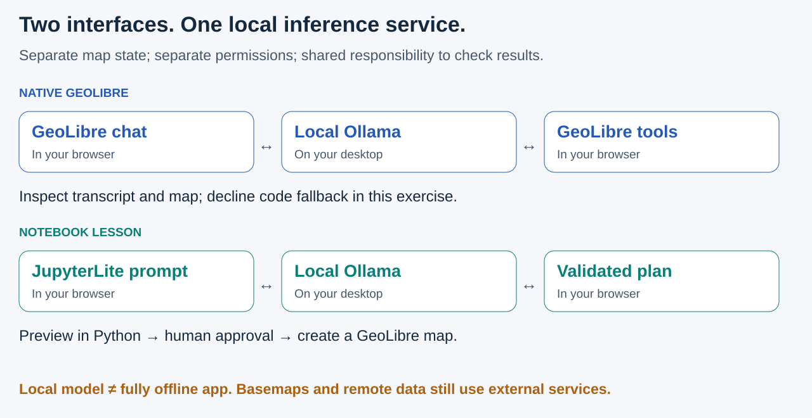
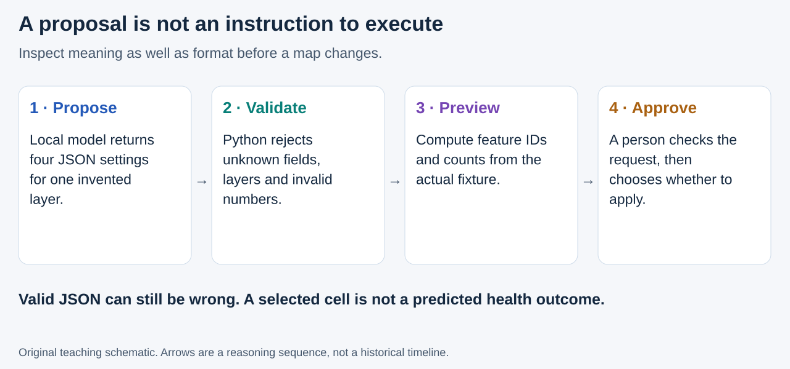

# Advanced: AI-assisted mapping with local Ollama

**Goal:** type a geographic request, see how it changes a map, and check the result. You will use **GeoLibre's native AI Assistant**, then inspect a smaller notebook-side implementation. These are two different interfaces to a local model—not a claim that GeoLibre, Ollama or Global Nature Watch are the same product.

Start with [What is GeoLibre?](../platforms/geolibre.md) and [What is GeoAI?](../geoai/primer.md). You should be comfortable running notebook cells and reading a layer's attributes. Only public or invented data belongs in this public teaching workflow.

## Two ways to connect words and maps



**Read the picture:** inference happens in a desktop service. JupyterLite's Python still runs in the browser. GeoLibre's full app owns its native conversation and map state; a notebook's embedded viewer is a separate instance. Re-running a notebook does not synchronize an already-open full-app project.

| Route | What you can do | Important limit |
|---|---|---|
| **Native GeoLibre assistant** | Ask the application to inspect layers and perform supported GIS/map operations | Its available tools are broader than our notebook allowlist; inspect its transcript and any code-approval requests |
| **Notebook planner** | Translate a request into four settings for one synthetic layer, then preview and approve | No arbitrary code, SQL, data URLs, STAC retrieval or general-purpose GIS agent |

GeoLibre's provider implementation connects Ollama through its compatible `/v1` interface. Our small helper uses Ollama's native `/api/chat`, with structured output and a separate Python validator. Neither requires a hosted-model API key. [GeoLibre provider source](https://github.com/opengeos/GeoLibre/blob/734c7963b57f508500c5745361a4afc52763671c/apps/geolibre-desktop/src/lib/assistant/provider.ts), [Ollama chat API](https://docs.ollama.com/api/chat), [structured outputs](https://docs.ollama.com/capabilities/structured-outputs).

## What is inspired by Global Nature Watch?

[Global Nature Watch Horizon](https://horizon.globalnaturewatch.org/) presents natural-language access to geospatial datasets, maps, statistics and contextual explanations. Its overview describes agents and retrieval of supporting documentation. We borrow the **interaction idea**: question → geographic operation → visible result → evidence check. We do not copy its interface or imagery, connect to its agents, reproduce its data services, or claim equivalent capabilities. Credit: Global Nature Watch and Land & Carbon Lab, as identified in Horizon's overview.

Our example asks about a small invented grid, not live deforestation, ecosystem change or health risk. The benefit to test is whether novices can formulate and inspect a mapping operation—not whether fluent text makes a result true.

## Windows setup: local service, then browser permission

Ollama's **Apps** screen is a launcher for integrations. You do not need to select an app there. These lessons call the service that Ollama runs in the background.

1. In a terminal, run `ollama list`. Install a model only if needed. This lesson uses `ollama pull qwen3:4b`, a roughly **2.5 GB**, tool-capable model; inference also requires working memory. It is an example choice, not a guarantee of good GIS reasoning. [Official model card and license](https://ollama.com/library/qwen3:4b).
2. In Windows, open **Edit environment variables for your account**. Set user variable `OLLAMA_ORIGINS` to the exact value below. Preserve any existing trusted origins you intentionally need; do not use `*`.
3. **Quit Ollama from its system-tray menu**, then reopen it. Closing the main window may leave its old server running. Keep the default loopback listener; no LAN binding, tunnel or public proxy is needed. [Ollama server configuration](https://docs.ollama.com/faq).

```text
https://web.geolibre.app,https://jltobias.github.io
```

These are **origins**, not repository URLs: permission for `https://jltobias.github.io` covers all paths on that origin. The first origin supports GeoLibre's native UI; the second supports these published notebooks. A locally hosted copy has a different origin and must be considered separately.

Open [GeoLibre Web](https://web.geolibre.app/) in a top-level tab. Configure **Settings → AI Providers → Ollama**, base URL `http://127.0.0.1:11434`, model `qwen3:4b`. Then open **Processing → AI Assistant**. GeoLibre's documented local-provider setup is the authoritative guide if its labels change. [GeoLibre AI Assistant](https://geolibre.app/user-guide/ai-assistant/), [provider fields at the reviewed revision](https://github.com/opengeos/GeoLibre/blob/734c7963b57f508500c5745361a4afc52763671c/apps/geolibre-desktop/src/lib/assistant/provider-fields.ts).

Your browser may separately request **Local Network Access** permission. Grant it only to the trusted page you intend to use. It does not replace Ollama's origin configuration. Managed browser policy can prohibit access; do not disable security flags to work around it. [Chrome's Local Network Access explanation](https://developer.chrome.com/blog/local-network-access).

### Three lessons, three evidence checks

| Lab | What you practice | Independently check |
|---|---|---|
| [18 · Setup and native GeoLibre chat](../notebooks/18_ollama_geolibre_setup.ipynb) | Diagnose local connectivity; export/open a project; issue native map prompts | The source contains **12 invented polygons** |
| [19 · Chat to a validated map plan](../notebooks/19_ollama_chat_to_map.ipynb) | Optional local inference; JSON validation; dry run; human approval | The supplied `>=39` request selects **7** cells |
| [20 · Follow-up and evidence review](../notebooks/20_ollama_evidence_review.ipynb) | Carry forward state; compare results; reject bad plans; use the perspectives card | Raising the threshold to `>=41` leaves **4** cells |

[Open the public synthetic project directly in GeoLibre](https://web.geolibre.app/?url=https%3A%2F%2Fjltobias.github.io%2FJupyterLite-GeoLibre-GeoAI%2Flite%2Ffiles%2Fdata%2Follama-demo.geolibre.json). The `url` parameter is GeoLibre's documented project-loading mechanism, not an AI integration. [Embedding and sharing](https://geolibre.app/user-guide/embedding/).

All three notebooks default to **no local-service requests**. Lab 18 requires `LIVE_CONNECT=True` to probe; labs 19–20 require `LIVE_MODEL=True` for inference. Default plans are authored fixtures, never presented as model outputs. The code clears old proposals before a new request, fails rather than silently substituting a fixture, and labels the response source. CI executes the offline paths; live behavior is checked separately and is model/machine dependent.

## Why a small map-plan vocabulary?



**Read the picture:** the JSON schema is a request to the model; validation is executable code. The helper accepts only `synthetic_cells`, a finite cutoff between 30 and 45, three named colors, and pitch 0 or 45. Unknown keys, URLs, imaginary layers and non-finite numbers are rejected. A correct type does not mean a correct interpretation: independently compare the four settings with your request.

Python—not the model—calculates which IDs pass the filter. The model proposes a parameterized operation. It does not estimate heat, flood depths, exposed population, TB incidence or service access. A 45-degree camera tilts flat polygons; it does not construct terrain or a learned world model.

The helper is an educational boundary, **not a sandbox for hostile users**. Anyone editing the notebook can change its code. Its approval flag applies only to its own map application, not to GeoLibre's native assistant, browser extensions or other software.

## Privacy, tools and honest claims

Keep local inference distinct from “everything stays offline.” Hosted viewers, basemaps and data layers involve external requests. In GeoLibre, optional hosted routing/tool-search services and browser speech recognition can create additional data flows; keep them disabled and use typed prompts for this demonstration. Inspect the configured provider before every session. [GeoLibre assistant's privacy and optional-service discussion](https://geolibre.app/user-guide/ai-assistant/).

Native GeoLibre includes generated-code tools. At the reviewed source revision, code execution has a confirmation hook; direct MapLibre JavaScript changes can bypass normal undo. **Decline generated-code execution in this introductory native exercise** and inspect the tool transcript. A natural-language “do not run code” request is not enforcement. The notebook helper never offers these tools. [GeoLibre native tool implementation](https://github.com/opengeos/GeoLibre/blob/734c7963b57f508500c5745361a4afc52763671c/apps/geolibre-desktop/src/lib/assistant/tools.ts).

Never publish patient coordinates, HIV/TB records, credentials, or sensitive chat transcripts. A project export can contain data and settings; review it rather than assuming every application's export is safe. Our bundled project contains only invented cells. The helper limits requests to the loopback service, refuses redirects and remote-backed models, and makes no cloud fallback. None of those checks certifies the entire desktop as private or secure.

For a real STAC extension, first complete the [discovery chapter](../platforms/stac-discovery.md): identify the collection, item, asset role, license, timestamp, resolution and actual access method. Treat retrieved metadata as evidence, not executable instructions. An assistant must not invent a URL or infer that a footprint is a hazard measurement.

### If something fails

| Symptom | Check next |
|---|---|
| Connection refused | Is the Ollama background service running on loopback port 11434? |
| Empty model list | Install a model deliberately; the notebooks never download one automatically |
| HTTP 403 for a browser origin | Exact origin value, then a real server quit/restart—not just closing the window |
| Generic Fetch/NetworkError | Server reachability, origin configuration, Local Network Access, managed policy and browser console; the message alone does not identify CORS |
| Model appears but produces no useful tools | Confirm tool support and exact model tag; start with layer listing and one style change |
| Slow or incomplete response | First load can be slow; wait for the bounded request or stop it. Try the offline fixture. Do not treat partial JSON as a plan |
| Valid plan, wrong result | Check parameter meaning and selected IDs; do not approve or silently repair the model's answer |
| Old behavior after editing a notebook | Restart the kernel and run from the top; an exported full-app project is a separate copy |

## From chat assistance to geospatial intelligence

Use the [broader GIS/GeoAI discussion](../geoai/primer.md) and [lab 20's perspectives card](../notebooks/20_ollama_evidence_review.ipynb). A useful sequence is **question → source → operation → checked result → human interpretation → evaluated action**. Chat can assist a step; it does not collapse that chain into one authoritative answer.

For a global-health workshop, compare a simple manually entered filter with the assistant's proposal. Measure completion time, mistakes noticed, mistakes missed and the learner's ability to explain the result. These are proposed teaching-evaluation measures, not demonstrated health-program benefits. A real PEPFAR, TB, outbreak or climate–health deployment would require new data governance, validation and local accountability.

## Credits and reproducibility

**GeoLibre: Qiusheng Wu and contributors.** Cite Wu, Q. (2026), *GeoLibre: A lightweight, cloud-native GIS platform for visualizing, exploring, and analyzing geospatial data*, [doi:10.5281/zenodo.20785400](https://doi.org/10.5281/zenodo.20785400); see [official citation guidance](https://geolibre.app/citation/). We add teaching materials and a notebook adapter, not the upstream GIS or native assistant.

Ollama and Qwen retain their respective software/model credits and licenses. The Python map builders are pinned to `geolibre==3.0.0`; the independently hosted web app can change. GeoLibre integration sources were reviewed at `734c7963b57f508500c5745361a4afc52763671c`, 11 October 2026. Original SVG diagrams and captioned storyboards are explanatory schematics, not screenshots of successful AI runs. See the [reference register](../references.md) and the repository's `OLLAMA_VALIDATION.md` for test scope and limitations.
