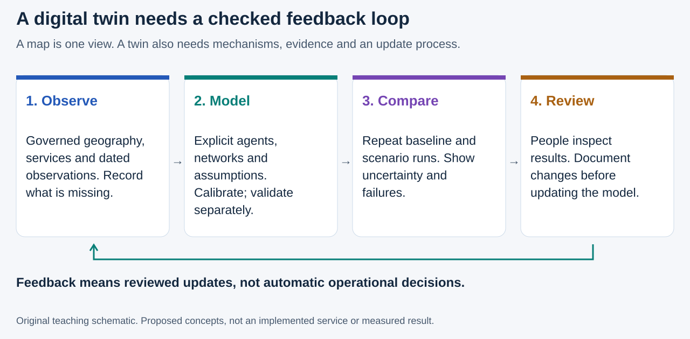
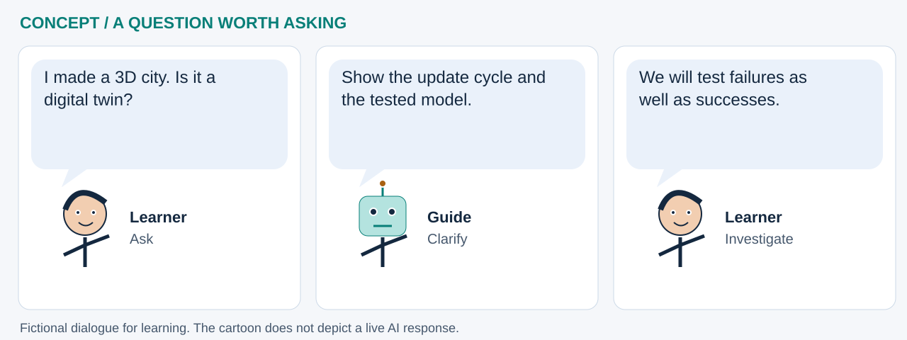

# Digital twins: a testable model, not just a 3D city

**Could we explore a proposed health-program change before trying it in the real world?** A digital twin connects a representation of a real system to data and models that can be updated and tested. It is a purposeful approximation, not a perfect replica. A 3D map shows appearance; a useful twin also explains what changes, why, how it is checked and when its evidence expires. NIST describes digital twins as models supporting monitoring, prediction and decisions; its examples do not validate a public-health implementation. [Source: NIST, *Digital twins*](https://www.nist.gov/digital-twins).

This chapter is informed by the supplied **27 August 2026 Gaborone TB presentation**, especially PDF pages 4-5, 7-19 and 21-22. It describes potential connections to **this** repository. The separate presentation's notebook numbers 00-19 are **not** the same lessons as our labs 00-17. No Gaborone disease model or patient-level data has been imported here.

## Read the feedback loop

**Read the picture:** observations constrain a model; they do not make it automatically correct. Scenario results return to a reviewer, not directly to an operational decision. A documented update cycle distinguishes an evolving twin from an attractive one-off simulation. Each revision should preserve inputs, dates, parameters, code, uncertainty and the decision it was intended to support.

*Figure DT1: original teaching schematic for this book, informed by the supplied Gaborone presentation, PDF pages 4-5, 16-17 and 20-22. It is not a screenshot or measured result from that project.*

## What the Gaborone example contributes

The presentation connects neighborhood and building layers, population allocation, walking and combi transport networks, facility access, a synthetic population, disease-state transitions and intervention comparisons. It describes **Starsim** as the disease-simulation kernel and a separate **Community Health Simulation Platform (CHSP)** layer for orchestration and evaluation. These are descriptions from the slides, not an independent audit of that implementation. [Presentation, PDF pages 7-14 and 16-20; attribution below.]

In an **agent-based model (ABM)**, an agent is a simulated entity with a state and rules - for example, an invented resident assigned to a household and transport network. It is not necessarily an LLM assistant. Starsim's official documentation describes agents, transmission networks, interventions and calibration. A mechanistic ABM need not use machine learning at all. [Source: Starsim project](https://starsim.org/).

The Kopanyo study provides research context, not permission to publish participants' locations or evidence that a particular twin predicts TB accurately. For example, Baker and colleagues' 2023 analysis combined genomic and geographic information and found heterogeneous spatial patterns across outbreak groups. The paper discusses privacy protection and study limitations. It does not establish that any pair of nearby people transmitted infection to one another. [Baker et al., *Emerging Infectious Diseases*, 29(5)](https://wwwnc.cdc.gov/eid/article/29/5/22-0796_article).

## Where GeoAI fits - and where it does not

| Component | Potential contribution | Existing learning step |
|---|---|---|
| Spatial inputs | Prepare population, imagery, footprints and environmental features | [WorldPop/H3 lab 01](../notebooks/01_worldpop_h3.ipynb), [STAC lab 08](../notebooks/08_stac_geoai_footprints.ipynb) |
| Learned features | Explore groups or image patterns; validate labels and transfer to a new place | [Clustering lab 02](../notebooks/02_census_geoai_counties.ipynb), [imagery lab 03](../notebooks/03_earth_observation_geoai.ipynb) |
| Mechanistic model | Specify movement, contacts, disease transitions and service constraints | **Not implemented here**; [lab 15](../notebooks/15_astra_network_accessibility.ipynb) teaches a small deterministic network experiment, not disease transmission |
| Display and explanation | Compare 2D layers, 3D geometry, time trajectories and scenario assumptions | [Terrain lab 14](../notebooks/14_astra_terrain_3d.ipynb), [report lab 16](../notebooks/16_sea_level_rise_sat_scan_geoai.ipynb) teach display interpretation, not an operational twin |
| Human review | Challenge evidence, missing voices and unintended harms | [Six-perspectives lab 17](../notebooks/17_rewiring_global_health_six_hats.ipynb) |

GeoAI could help derive a building-use feature or identify model residual patterns. That learned component needs its own evaluation. Neither AI-assisted coding nor a realistic rendering validates the epidemiology. [GeoLibre](../platforms/geolibre.md), created by **Qiusheng Wu and contributors**, can display geographic evidence; it does not by itself supply or validate a disease kernel.

## What questions might a program investigate?

These are **proposed research questions**, not results of the current notebooks:

- **TB:** How might transport barriers and diagnostic delays interact? Compare explicit service scenarios under multiple plausible contact and care-seeking assumptions.
- **HIV/TB service continuity:** What happens to reachable services if a clinic or transport link is unavailable? Couple access, staffing and demand only where appropriate data and governance support the model.
- **Climate and emergencies:** Which service-access assumptions fail during a flood or heat event? A hazard layer must have defensible scenario definitions and dates before it can drive an experiment.

The presentation's intervention examples include diagnostic access, outreach, contact tracing and preventive treatment. These motivate comparisons, not a recommendation that a named package is optimal. A modeled benefit is conditional on inputs and mechanisms; program decisions need qualified local review.

## What makes a result worth trusting?

Separate **verification** (does the code implement its rules?), **calibration** (can parameters reproduce selected targets?) and **validation** (does the model reproduce independent patterns relevant to its intended use?). A good fit to calibration data is not independent validation. This is the book's proposed review framework, extending the presentation's calibration and limitations discussion.

Before a program pilot, specify a baseline, held-out place/time checks, repeated random seeds, plausible parameter ranges, alternative mechanisms, missing-data tests and equity measures. Show distributions and failure cases, not just one animated trajectory. Stop using a model when its inputs, operating conditions or intended decision no longer match the reviewed version. Protect communities from stigmatizing labels and inferred individual risk.

**Cartoon transcript:** “I made a 3D city. Is it a digital twin?” → “Show the update cycle and the tested model.” → “We will test failures as well as successes.” This fictional exchange distinguishes presentation from evidence.

## A realistic browser learning path

JupyterLite can teach small, inspectable components and display appropriately released summaries from heavier runs. **This repository has not established Starsim/CHSP compatibility with Pyodide** and does not install that stack. Large ensembles and calibration should be planned for a tested full-Python environment; publish only approved aggregate outputs back to the Book. A future toy notebook should use invented agents, explicit assumptions and an unmistakable “not a disease forecast” label.

Try this now: run [lab 15](../notebooks/15_astra_network_accessibility.ipynb), change its bridge assumption, and list what is missing before calling it a health-service twin: observed inputs, an update process, capacity and demand, validation and an accountable owner.

## Sources and attribution

- **Supplied presentation:** *Digital Twins: Botswana Kopanyo TB Study (2012-2016) for Gaborone TB simulation*, 27 August 2026, 22 PDF pages. Cover credits **James L. Tobias, Herman Tolentino and Tadesse Wuhib**, and names **Patrick Moonan and John Oeltmann** of the CDC Global TB Branch. File: `Gaborone-Digital-Twin-TB_Agent-Based-Modeling-8272026.pdf`. Page numbers here refer to PDF order. See the [provenance register](../assets/futures/provenance.json) for the source hash.
- **Primary public references:** [NIST digital twins](https://www.nist.gov/digital-twins), [Starsim project and contributors](https://starsim.org/), [Baker et al. (2023), doi:10.3201/eid2905.220796](https://wwwnc.cdc.gov/eid/article/29/5/22-0796_article). Accessed 11 October 2026.

The two diagrams are original educational artwork, not reproductions of slide graphics. The source PDF and its separately hosted implementation are not redistributed or certified. This chapter implies no endorsement by the presentation's organizations, software projects or study participants.

**Continue:** [Map encryption and geoprivacy](map-encryption.md) explains why a detailed twin needs a careful data-release boundary.
