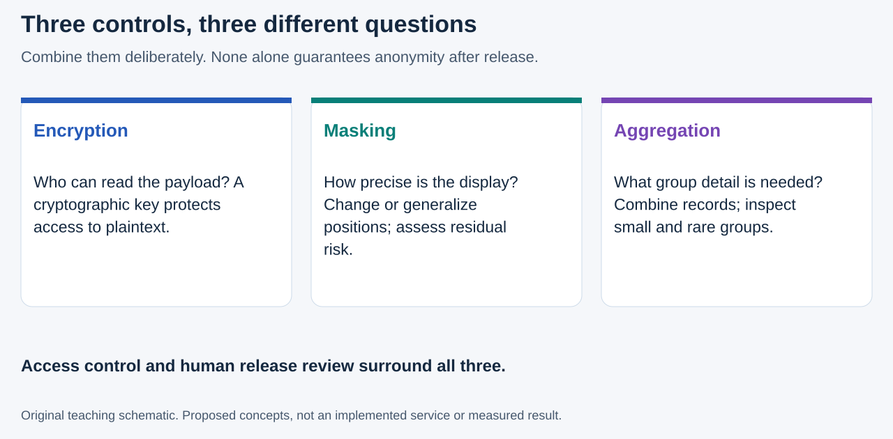
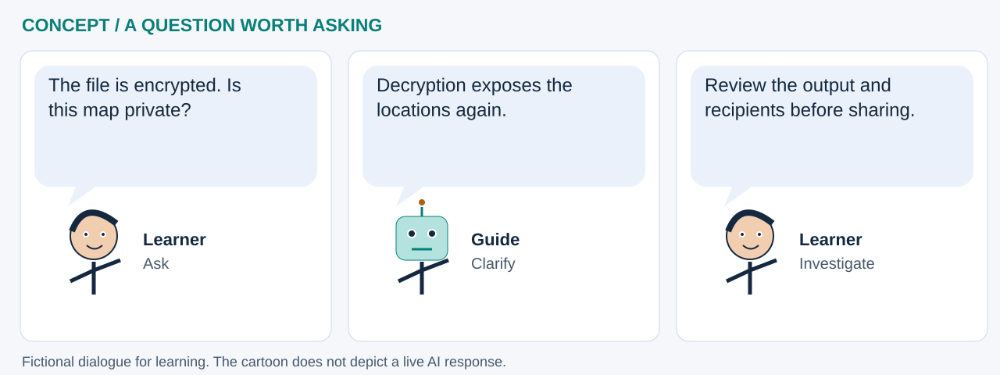

# Map encryption: protect the data, then review the map

**How can partners learn from geographic evidence without exposing sensitive people or places?** Encryption is one part of the answer. It protects a data payload using cryptographic keys; it does not automatically make the decrypted map anonymous or safe to publish.

This section is informed by the supplied **21 September 2026 presentation, *Map Encryption Democratized with JupyterLite***. It uses the deck's separation of encryption, geomasking, aggregation, keys and output review. This is an explanatory chapter, **not an implemented encryption service, security audit or approval to upload confidential data**. The presentation describes a separate library; that code has not been imported or security-reviewed here.

## Four controls that answer different questions

**Read the picture:** the three boxes are complementary controls, not successive strength levels. Encryption helps answer “who can read this payload?” Masking asks “how precisely should a location be displayed?” Aggregation asks “which group-level information is necessary?” **Access control** adds a fourth question: who is authorized to request an operation or export? The presentation makes these distinctions on PDF pages 7-10.

| Control | Example | What it does not establish |
|---|---|---|
| Encryption | An encrypted geospatial file shared separately from its key | The decrypted records are anonymous, or an authorized recipient cannot copy them |
| Masking/generalization | Replace an exact point with a coarser display location | A cryptographic confidentiality guarantee or preserved distance relationships |
| Aggregation | Publish a reviewed area-level count | Safety of every small cell, rare event or combination with other data |
| Access control | Authenticate a user and authorize a specific data operation | Secrecy of plaintext already exported or a screenshot already shared |

Removing names, hiding a map layer, using Base64, or putting exact coordinates in an H3 cell is not encryption. Small-area or low-count displays still need a disclosure review. These are teaching cautions, not a claim that any single masking distance or cell resolution is safe for all settings.

## Follow the data across the boundary

A proposed teaching workflow is: **minimize a synthetic layer → serialize it → encrypt with a reviewed implementation → distribute ciphertext separately from keys → authorize decryption → inspect and release only an approved view**. The deck's PDF pages 12-14 and 27-30 emphasize these handoffs. The illustration on page 12 also separates protected geometry from approved attributes and controlled recovery; that architecture is a proposal to scrutinize, not proof of security.

Authenticated encryption protects confidentiality and detects unauthorized changes to the protected payload. For example, NIST specifies GCM as authenticated encryption with associated data. That is not evidence that the presentation's library uses a particular algorithm correctly. Algorithm choice, nonce handling, password-to-key derivation, key storage and recovery require specialist review. Do not invent a custom cipher or treat a successful encrypt/decrypt round trip as a security audit. [NIST SP 800-38D](https://csrc.nist.gov/pubs/sp/800/38/d/final); [W3C Web Cryptography security considerations](https://www.w3.org/TR/webcrypto/#security-considerations).

**Cartoon transcript:** “The file is encrypted. Is this map private?” → “Decryption exposes the locations again.” → “Review the output and recipients before sharing.” This original fictional exchange highlights the difference between protected storage and a released visualization.

## The browser is part of the threat model

The browser application can access plaintext it decrypts. Hostile scripts can compromise data or keys, and browser key-storage behavior does not amount to a universal secure-vault guarantee. Web Crypto provides building blocks, not an entire trustworthy application. Its security discussion also notes that shared keys and already released content cannot simply be recalled by the original application. [Source: W3C Web Cryptography, sections 5.2 and 6](https://www.w3.org/TR/webcrypto/#security-considerations).

In this repository, `LiteMap` loads **GeoLibre's externally hosted viewer** and passes project contents into that frame. Remote layers, basemaps, optional external AI requests, notebook downloads and saved outputs create additional data destinations. Browser-side Python does **not** mean everything stays private on your computer. Consult the [documented GeoLibre runtime boundary and attribution](../platforms/geolibre.md) and [JupyterLite saving guidance](../platforms/jupyterlite.md).

For this public teaching site, use public or invented data only. Do not place patient addresses, HIV/TB status, case line lists, precise contact networks or real secrets into a notebook, shared map project, repository, browser local storage, screenshot or external model prompt. The presentation's operational-security ideas require an approved environment and governance beyond this static site.

## Connections to existing lessons

| Existing lesson | What to examine now | What would be a future addition? |
|---|---|---|
| [H3 lab 01](../notebooks/01_worldpop_h3.ipynb) and [earthquake lab 05](../notebooks/05_h3_earthquake_geoai.ipynb) | How cell resolution changes detail and interpretation | A synthetic disclosure-risk exercise; neither lab implements encryption |
| [STAC lab 07](../notebooks/07_stac_browser_catalogs.ipynb) | Collection licenses, asset destinations and metadata | A reviewed encrypted-asset workflow; STAC discovery does not grant authorization |
| [Evidence lab 16](../notebooks/16_sea_level_rise_sat_scan_geoai.ipynb) | What is embedded in tables, charts and downloadable notebooks | Explicit release rules for a properly governed report derivative |
| [Discussion lab 17](../notebooks/17_rewiring_global_health_six_hats.ipynb) | Who may be harmed by a release, and who must approve it? | A recorded threat model and accountable disclosure review |

GeoLibre is the visualization software created by **Qiusheng Wu and contributors**; this chapter does not claim that it implements the separate Map Encryption Library or certifies a user's data-protection workflow.

## Potential value for global health

Encrypted, governed exchange could help partners share approved geographic inputs without storing readable copies at every handoff. Separately reviewed aggregate outputs could support service planning or a [digital-twin experiment](digital-twins.md). These are potential workflow benefits, not measured privacy or health outcomes. Exact household locations, linked diagnoses and mobility histories can make a twin especially sensitive; protecting a file does not remove that risk when the model or map is opened.

Before any operational prototype, ask: what needs protection, from whom, in which environment, for how long, and who can authorize release? Track whether filenames, bounding boxes, join keys, thumbnails, logs and model outputs leak context. Decide how to handle lost keys and revocation; revoking future access does not erase previously decrypted copies.

## A safe novice exercise

Using the public example in [lab 00](../notebooks/00_geolibre_quickstart.ipynb), list every place its information appears: source file, Python variable, widget project, rendered map and notebook output. Mark where an encrypted input would become plaintext. Then propose a minimal aggregate result for a fictional partner. No real secrets or patient data are needed, and no encryption capability is implied by completing this exercise.

## Sources and attribution

- **Supplied presentation:** *Map Encryption Democratized with JupyterLite*, cover date **21 September 2026**. Cover credits **Herman Tolentino, James L. Tobias, Tadesse Wuhib and Vinit Mishra**. File: `Map_Encryption_JupyterLite_9212026.pdf`, 36 PDF pages. The PDF export metadata is dated 4 October 2026; the cover date is used for the presentation citation. PDF page 7 is printed slide 15, page 12 is slide 19, and pages 27-30 are slides 39-42. See the [source provenance register](../assets/futures/provenance.json).
- **Primary technical references:** [NIST SP 800-38D](https://csrc.nist.gov/pubs/sp/800/38/d/final); [W3C Web Cryptography security considerations](https://www.w3.org/TR/webcrypto/#security-considerations). Accessed 11 October 2026. These references explain primitives and browser risks; neither endorses this repository or verifies the separate library.

The two illustrations are original teaching schematics, not copied slide graphics. The source PDF and separately hosted library are not redistributed. No security mechanism or cryptographic dependency is added by this chapter. Presentation ideas are paraphrased and attributed, and do not imply organizational endorsement.
