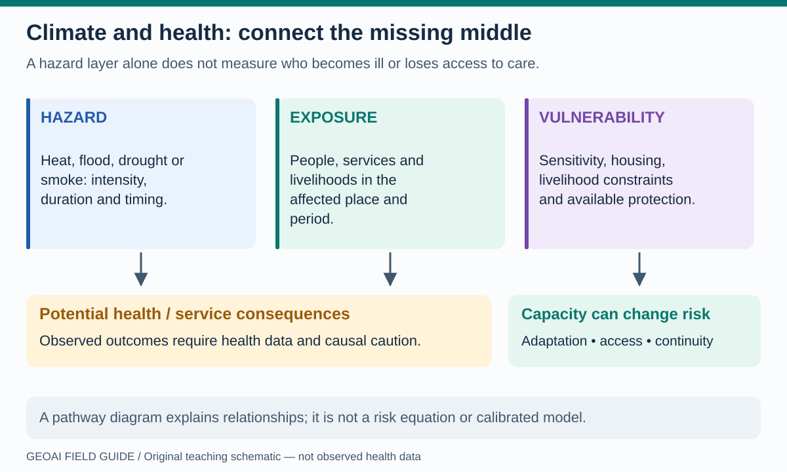
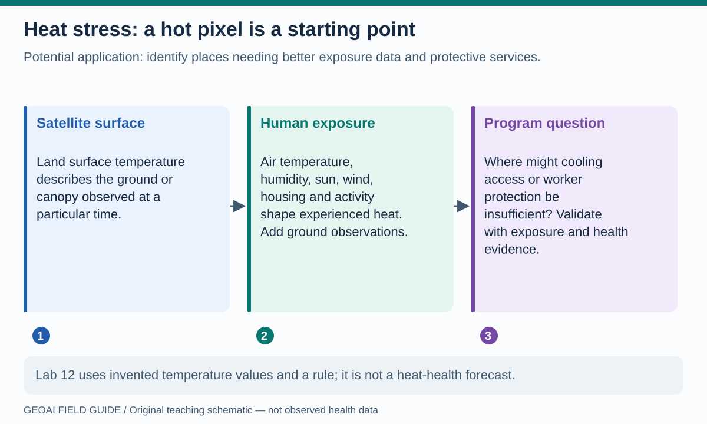
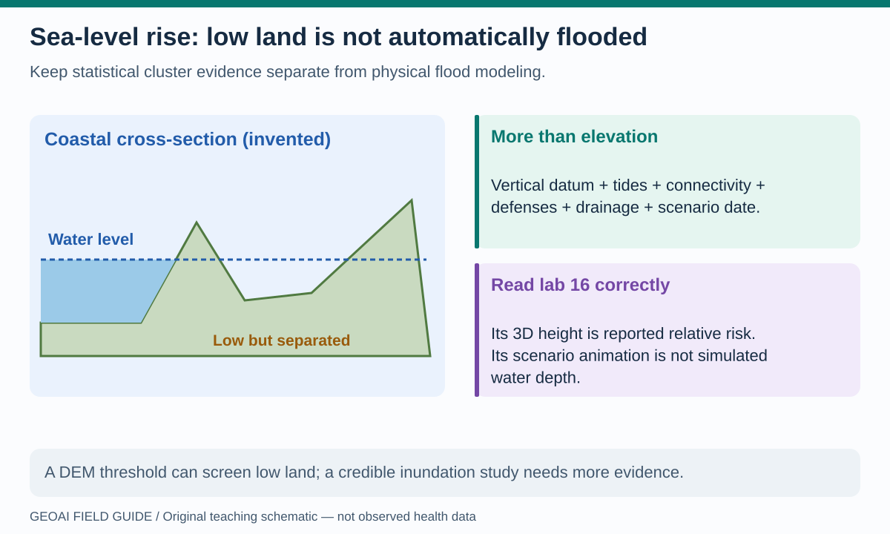
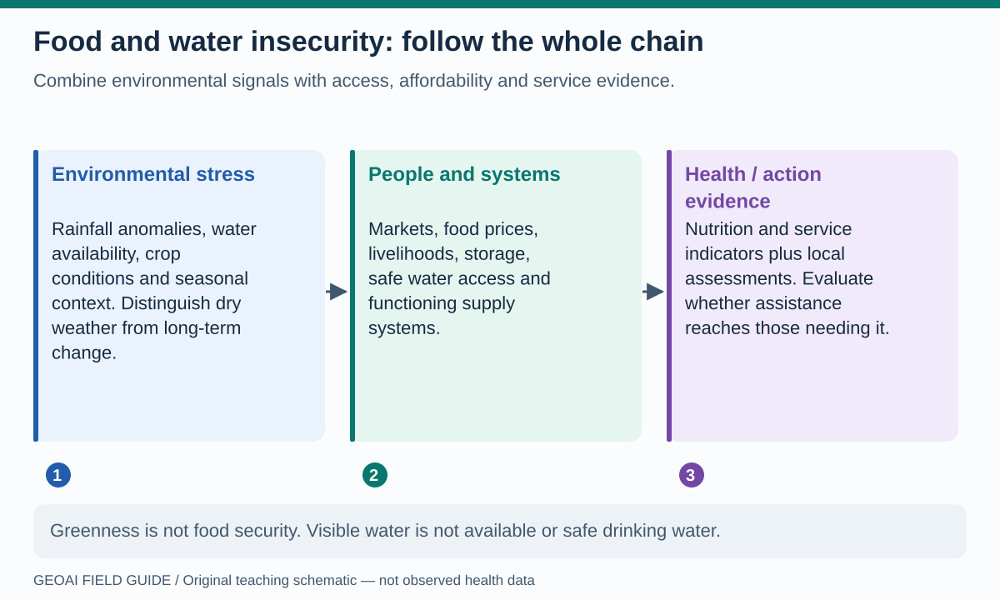
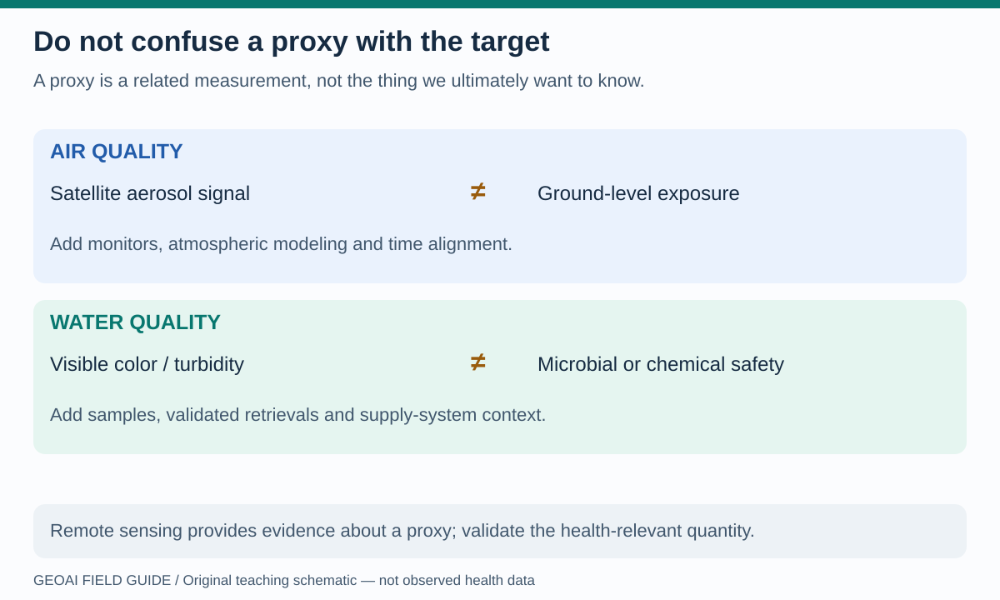

# Climate and health: make the pathway visible

**A hazard map is not a health-outcome map.** Heat, floods, drought and environmental change interact with exposure, vulnerability and the capacity to respond. The [WHO climate-change overview](https://www.who.int/health-topics/climate-change) describes direct and indirect health pathways. The original diagrams here turn those relationships into questions a beginner can investigate; they are not quantitative risk models.

## Start with hazard, exposure, vulnerability and capacity

**Read the picture:** a flood polygon describes a hazard footprint. Intersecting it with a population surface estimates exposure under that dataset's assumptions. Neither operation directly measures illness, ability to evacuate or access to care. Health outcomes and service impacts need additional evidence. Do not multiply arbitrary scores and present the result as a calibrated probability.

GeoAI may help classify imagery, combine features, flag unusual patterns or make conditional predictions. Its value must be tested against simpler approaches. A causal claim—“this climate exposure caused this health outcome”—requires a design addressing alternative explanations, not merely a strong model association.

## Heat stress: surface, exposure and health are different layers

**Read the picture:** a satellite's land-surface temperature is not the weather station's air temperature, as [NASA's explanation](https://science.nasa.gov/earth/earth-observatory/global-maps/land-surface-temperature/) makes clear. Heat exposure also depends on humidity, wind, radiation, activity and living conditions; [WHO's heat-and-health guidance](https://www.who.int/news-room/fact-sheets/detail/climate-change-heat-and-health) discusses these dimensions and health-system impacts.

**Try the method:** [lab 12](../notebooks/12_astra_spatial_copilot.ipynb) uses invented temperatures and a chosen selection rule. Change the cutoff and inspect how many synthetic cells qualify. That is sensitivity analysis, not a learned heat-health forecast. [Lab 03](../notebooks/03_earth_observation_geoai.ipynb) uses RGB appearance, not a thermal product.

**Potential program use:** screen where better exposure measurement, cooling access or worker-protection planning may be needed. Add validated meteorology, population and vulnerability information, service access and appropriate health observations. Test spatial/time transfer, subgroup errors and whether an intervention actually improves protection. A single hot acquisition cannot establish chronic exposure.

## Sea-level rise and flood risk: keep the units honest

**Read the picture:** some land below a selected water level is separated from the sea. Elevation alone does not represent all connectivity, defenses or drainage. Vertical reference systems, tides, local land motion and scenario dates matter. [NOAA's Sea Level Rise Viewer](https://coast.noaa.gov/digitalcoast/tools/slr.html) illustrates connectivity and confidence information for its U.S. coastal coverage; it is not a global dataset for the ten cities in this book.

**Read lab 16 correctly:** the [sea-level-rise / SaTScan notebook](../notebooks/16_sea_level_rise_sat_scan_geoai.ipynb) uses aggregate results extracted from the supplied Power BI report. Its ten representative cities belong to that report's selected cluster results, not a verified current worldwide ranking of the ten cities at greatest flood risk. It does not rerun SaTScan, fit a new AI model, or produce a hydrodynamic simulation. Its 3D points use height to encode **reported relative risk**, not meters of water. Scenario animation changes displayed report indicators, not a simulated advancing flood.

The cluster statistics and city scenario summaries have different denominators. A representative city point is not a cluster boundary. Do not divide indicators across those tables without establishing compatible populations and definitions.

**Potential program use:** examine where coastal disruption could threaten facilities, roads or continuity of care. [Lab 14](../notebooks/14_astra_terrain_3d.ipynb) teaches terrain using an invented surface, and [lab 15](../notebooks/15_astra_network_accessibility.ipynb) teaches network disruption. A real-city extension needs validated terrain and water levels, physical assumptions, exposure data, flood observations and local expertise. Any future storymap should show scenario date, units, uncertainty and service consequences, with a clear separation between measured evidence and simulation.

## Food and water insecurity: environmental signals are only one link

**Read the picture:** greener vegetation does not establish affordable food access. A visible reservoir does not establish reliable household water access. [FEWS NET's guidance](https://fews.net/products/guidance-documents) combines multiple forms of evidence in food-security analysis; it is a useful reminder not to turn one satellite index into a nutrition diagnosis.

**Notebook bridge:** [lab 04](../notebooks/04_chirps_climate.ipynb) teaches rainfall representation, [07](../notebooks/07_stac_browser_catalogs.ipynb) and [08](../notebooks/08_stac_geoai_footprints.ipynb) help discover data, and [15](../notebooks/15_astra_network_accessibility.ipynb) illustrates access barriers. A real early-warning extension needs observed time series, seasonal baselines, crop calendars, markets, livelihoods, supply systems and locally verified outcome indicators.

**Potential benefit to test:** earlier, more transparent assessment of assistance needs. Evaluate forecast timing and errors, actual reach of assistance, and populations excluded by incomplete data. Drought, food insecurity and malnutrition are related but not interchangeable labels.

## Air and water quality: validate the health-relevant quantity

**Read the picture:** a proxy is a related measurement. Satellite aerosol optical depth describes an atmospheric-column signal, not directly a person's near-surface PM2.5 exposure. NASA's [training announcement on estimating surface PM2.5](https://forum.earthdata.nasa.gov/viewtopic.php?t=7992) describes combining satellite information with other sources, including ground monitors and models.

Water color or turbidity can inform environmental monitoring, but does not certify microbial or chemical safety. The [WHO water-safety and quality program](https://www.who.int/teams/environment-climate-change-and-health/water-sanitation-and-health/water-safety-and-quality) provides guidance on managing drinking-water risks. Field sampling, locally validated retrievals and supply-system information remain necessary.

**Notebook bridge:** [03 · pixels](../notebooks/03_earth_observation_geoai.ipynb) and [13 · change and errors](../notebooks/13_astra_vision_change.ipynb) teach representations, not calibrated air- or water-quality retrievals. Potential extensions could prioritize monitoring locations or investigate unusual changes. Compare predicted concentrations with independent measurements, inspect missing cloudy periods and test whether monitoring choices improve coverage. Never label a pixel “safe to drink” from appearance alone.

**Reflection:** for your chosen climate-health question, name the hazard, exposure, health-relevant target, proxy measurements, alternative explanations and possible action. Which one is actually calculated in the notebook?

**Next:** [Vector shifts, migration, conflict and accountable decisions](climate-society.md).
