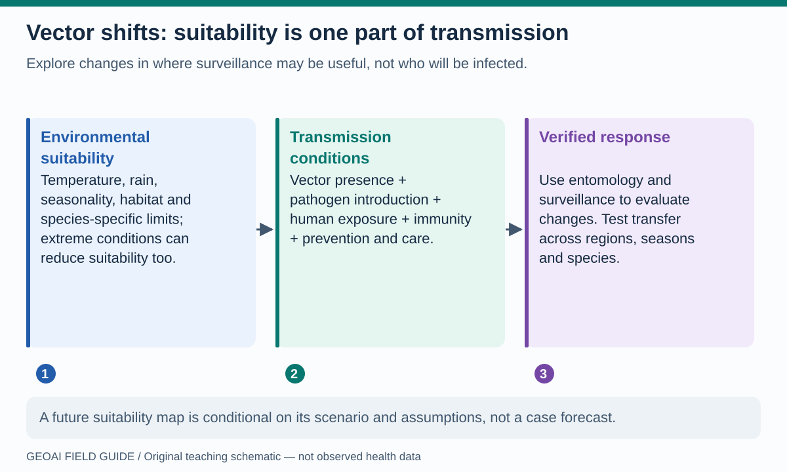
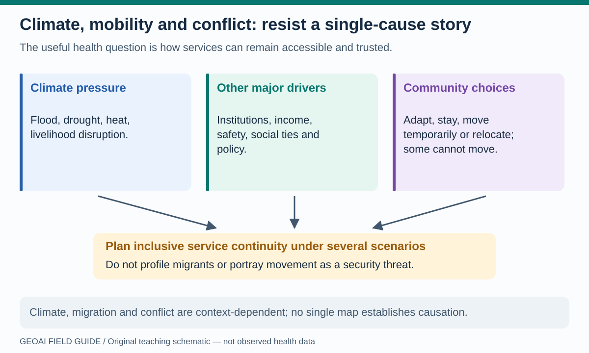
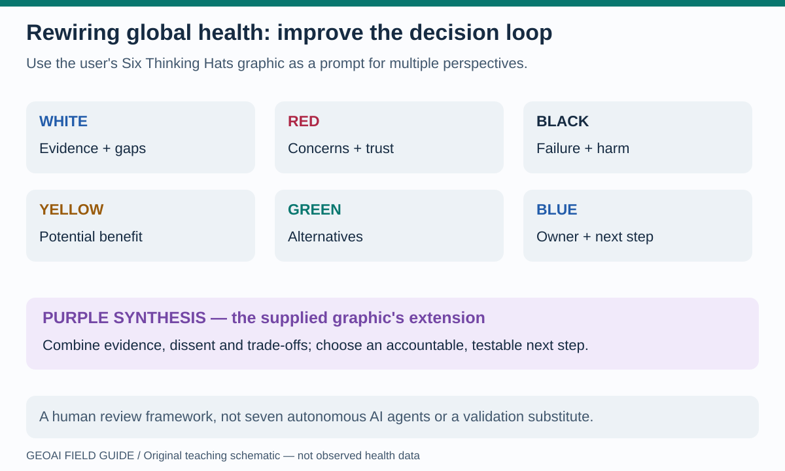

# Vector shifts, social pathways and accountable decisions

Climate-sensitive health questions often span ecological and social systems. These pages describe potential uses of GeoAI for **supporting services and learning**, not predicting individual behavior or identifying communities as threats.

## Vector distribution shifts: suitability is not transmission

**Read the picture:** a suitable environment may support a vector, but infection also depends on pathogen presence, exposure, prevention and other conditions. Climate effects vary by species and place; “warmer” does not always mean “more suitable.” [WHO's vector-borne disease overview](https://www.who.int/en/news-room/fact-sheets/detail/vector-borne-diseases) describes the demographic, environmental and social influences on disease distribution.

**Notebook bridge:** [04 · rainfall](../notebooks/04_chirps_climate.ipynb), [08 · STAC metadata](../notebooks/08_stac_geoai_footprints.ipynb) and [02 · feature profiles](../notebooks/02_census_geoai_counties.ipynb) teach parts of data preparation and pattern exploration. They do not fit species-distribution or transmission models. A transfer needs species-specific vector observations, comparable sampling effort, temporal alignment and a clear target such as habitat suitability—not an undefined “disease risk” label.

**Potential benefit to test:** choosing where additional surveillance could resolve uncertainty. Hold out regions and seasons, inspect extrapolation into unfamiliar climates, compare with a simple ecological baseline and verify vector presence in the field. A future scenario is conditional on climate inputs and assumptions, not a forecast of case counts. Revisit the [malaria use case](outbreaks.md) before connecting suitability to program decisions.

## Migration and conflict: ask better questions of the map

Climate hazards can influence displacement and migration, but responses depend on resources, social ties, policy and other conditions. Climate can also interact with conflict risks; it is not a single sufficient cause. The [IPCC AR6 assessment, Chapter 7](https://www.ipcc.ch/report/ar6/wg2/chapter/chapter-7/), emphasizes context and interacting drivers. It does not support inferring a person's migration intention or a group's propensity for violence from climate exposure.

**Read the picture:** arrows converge on a service-planning question, not on a deterministic prediction that people will move or conflict will occur. People may stay by choice, lack resources to leave, move temporarily or relocate. A responsible analysis must consider those who remain as well as those who move.

**Notebook bridge:** [15 · accessibility](../notebooks/15_astra_network_accessibility.ipynb) can illustrate a disrupted route, and [17 · perspectives](../notebooks/17_rewiring_global_health_six_hats.ipynb) can structure a discussion of assumptions and harms. Neither predicts migration or conflict. Potential extensions should use authorized aggregate scenarios, service-capacity information and community-led interpretation, not individual tracking or security profiling.

**Potential benefit to test:** preparedness for changes in service demand, continuity of HIV/TB care, and access to water, primary care or emergency referral under several plausible scenarios. Evaluate actual access and inclusion. Do not treat displaced people or host communities as disease vectors or security risks.

## Rewiring global health: change the decision process, not only the software

**Read the picture:** this adapts the *discussion structure* in the supplied artwork. Purple synthesis is the artwork's additional coordinating perspective, not one of the original six hats. The diagram represents people examining evidence together, not seven AI agents producing independent validation.

The original graphic remains available in [lab 17](../notebooks/17_rewiring_global_health_six_hats.ipynb) and below. Its embedded questions are teaching material, not instructions to the notebook runtime. The companion [Rewiring Global Health repository](https://github.com/jltobias/JupyterLite-Rewiring-Global-Health) provides the broader learning context.

That companion project traces “rewiring” to connecting people, evidence and methods around difficult public-health problems. Its lessons distinguish predictions from assumed simulation rules and causal claims, and treat privacy, human agency and review as part of the work. Here, the practical transfer is to connect a geographic result to a named decision, preserve dissent, compare alternatives and ask whether any gains justify potential harms. A more complex model or 3D scene does not remove those responsibilities.

Use this workshop on any map in the book:

| Perspective | Question to ask the analyst | Evidence to leave behind |
|---|---|---|
| White · evidence | What is observed, estimated, assumed or missing? | Sources, dates, units and uncertainty |
| Red · concerns | What feels untrustworthy or overlooks lived experience? | Community concerns recorded without dismissing them |
| Black · risk | Who could be harmed by an error or disclosure? | Failure cases and safeguards |
| Yellow · benefit | What practical improvement is plausible? | A measurable, testable benefit rather than an AI claim |
| Green · alternatives | Could a simpler model or nontechnical change help? | Baseline and alternative options |
| Blue · process | Who decides, verifies and revisits the result? | Owner, review date and stopping rule |
| Purple · synthesis | What do we agree to test, and where do we disagree? | A decision record retaining uncertainty and dissent |

This book's proposed approach is to make the chain **question → evidence → analysis → interpretation → decision → evaluation** inspectable. AI can assist parts of that chain, while accountable people retain responsibility. WHO's [health AI ethics guidance](https://www.who.int/publications/i/item/9789240029200) is a useful reference for governance; these prompts are not a substitute for a formal local review.

## Define success before drawing the next map

Choose one outcome: verified service continuity, faster laboratory turnaround, fewer missed settlements, better monitoring coverage or more equitable access. Name the baseline, intended population, evaluation period and plausible harms. Record what would make the team stop or change course. A model with attractive maps but no demonstrated decision benefit has not yet established its program value.

**Teach-back:** take a figure from [the notebook atlas](notebook-atlas.md). Explain its data, method, uncertainty and intended use to a colleague without using the word “AI.” Then state precisely what AI contributes, if anything.
