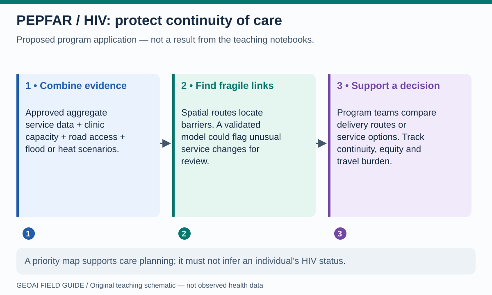
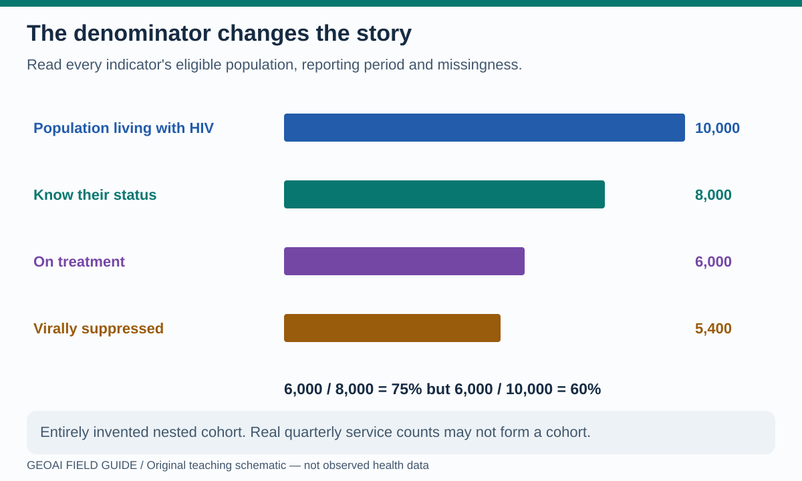
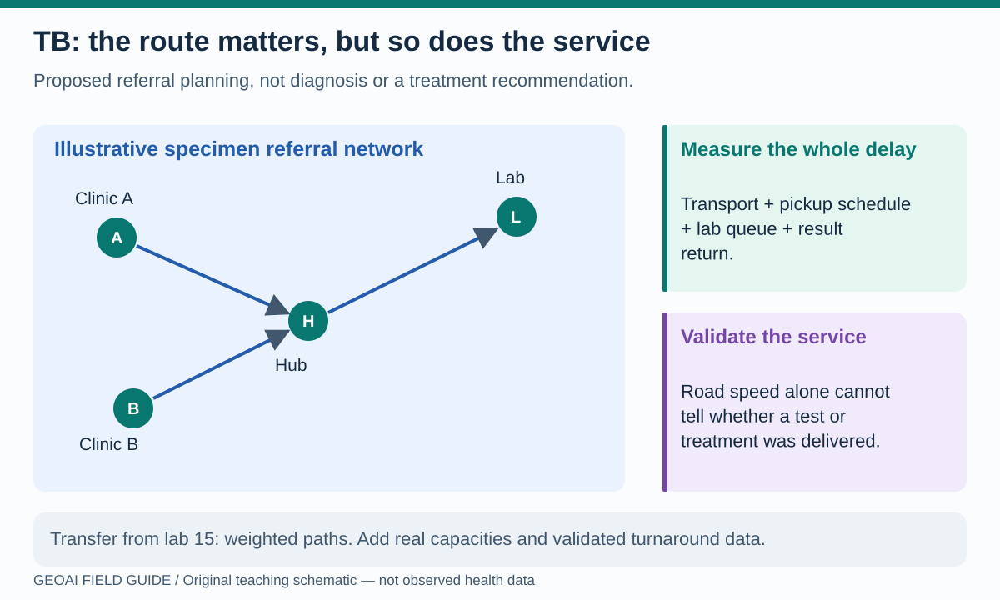

# GeoAI for PEPFAR, HIV and TB programs

The program question is not “Can AI draw a better map?” It is **“Can geographic evidence help people obtain and continue the services they need?”** The applications below are proposed extensions of the teaching methods, not claims of proven benefit or tools approved for operational allocation.

PEPFAR is the U.S. President's Emergency Plan for AIDS Relief. A [CDC analysis of PEPFAR-supported programs and surveys through 2022](https://www.cdc.gov/mmwr/volumes/72/wr/mm7212e1.htm) illustrates the use of program and subnational survey evidence. It is historical context, not a statement about today's funding or program configuration. GeoAI could complement such evidence with validated geographic features; it does not replace program expertise or community partnership.

## 1. Keep HIV services reachable during disruption

**Read the picture:** there are two separate analytical jobs. First, route calculations identify physical barriers. Second, a suitably validated model might flag unusual service changes. A flagged district calls for investigation: low counts could reflect reporting delays, changed facility coverage or genuine disruption.

**Notebook connection:** [lab 15](../notebooks/15_astra_network_accessibility.ipynb) demonstrates bridge closure and shortest paths; [lab 05](../notebooks/05_h3_earthquake_geoai.ipynb) demonstrates anomaly detection on a different domain. Neither predicts HIV interruption. A transfer would need authorized aggregate service indicators, current facilities and roads, a reporting-completeness assessment, and appropriate validation across places and periods.

**Potential benefit to test:** better planning of alternate delivery or referral options. Compare travel burden, verified service continuity, timeliness, workload and equity against current practice. A model must not infer individual HIV status from location or rank communities by presumed behavior.

## 2. Make indicators and denominators visible

**Read the picture:** this is arithmetic, not a country estimate, a target, or a PEPFAR performance result. Treatment coverage is 60% of the invented total cohort but 75% of the diagnosed subgroup. Both calculations are correct for their different denominators. Do not chain real service indicators as a cohort unless their definitions and populations permit it.

Program counts, survey estimates and modeled estimates answer different questions. The [UNAIDS AIDS Data Repository](https://adr.unaids.org/) supports country HIV estimation workflows, while the [UNAIDS AIDSinfo dataset](https://aidsinfo.unaids.org/dataset) provides estimates and usage guidance. Record the version, geography, period, uncertainty and denominator before merging sources.

**Notebook connection:** [lab 01](../notebooks/01_worldpop_h3.ipynb) introduces population geography and spatial aggregation; [lab 02](../notebooks/02_census_geoai_counties.ipynb) derives and clusters area features. For health programs, use rates with compatible denominators, assess missingness, and avoid confusing a cluster label with a measure of need. Population grids do not provide counts of people living with HIV.

**Try it:** use the invented chart to calculate suppression among those on treatment and among the total cohort. The answers are 90% and 54%. What would change if the reporting periods did not match? The arithmetic would remain possible, but the interpretation could be invalid.

## 3. Connect TB diagnosis and care through functioning networks

**Read the picture:** the fastest road route may not produce the fastest result if specimen pickup, lab capacity or result return is delayed. A useful network represents services and schedules, not only lines on a map.

**Notebook connection:** [lab 15](../notebooks/15_astra_network_accessibility.ipynb) teaches weighted shortest paths; [lab 10](../notebooks/10_sister_cities_graph_geoai.ipynb) teaches network features on a completely different partnership graph. A real TB referral application needs approved referral links, turnaround records, test availability, capacity and operational checks. The Sister Cities dataset must not be repurposed as a TB transmission network.

TB notifications count diagnosed and reported episodes, not all disease. The [WHO TB data portal](https://www.who.int/teams/global-tuberculosis-programme/data) distinguishes reported program data and estimated burden. A low-notification area could reflect lower burden, weaker detection, incomplete reporting or a mixture; a model cannot settle that ambiguity from counts alone.

**Potential benefit to test:** shorter verified turnaround and more complete referral pathways. Compare proposed routes against actual logistics, capacity and patient-centered outcomes. This is program planning, not advice about individual diagnosis or treatment.

## A small pilot that can earn trust

Start with synthetic or approved aggregate data, one decision and an accountable country/program team. Compare a transparent GIS baseline with any learned model. Test transfer to held-out districts and later periods, check who might be missed, and provide an appeal or correction process. Suppression of small counts alone may not prevent re-identification when maps and tables can be combined.

Keep patient locations, individual HIV/TB records, sensitive facility information and API credentials off the public repository and hosted viewer. Review all exports, including embedded notebook outputs, before sharing. Use [lab 17](../notebooks/17_rewiring_global_health_six_hats.ipynb) to bring evidence, benefits, concerns and alternatives into the same decision.

**Next:** [Polio, malaria, Ebola and emergency response](outbreaks.md).
