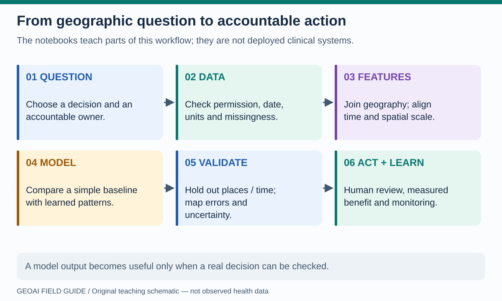
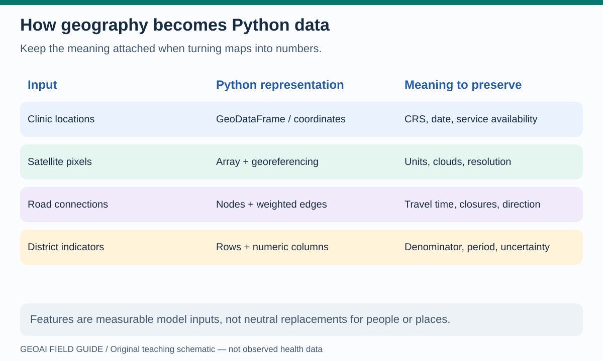
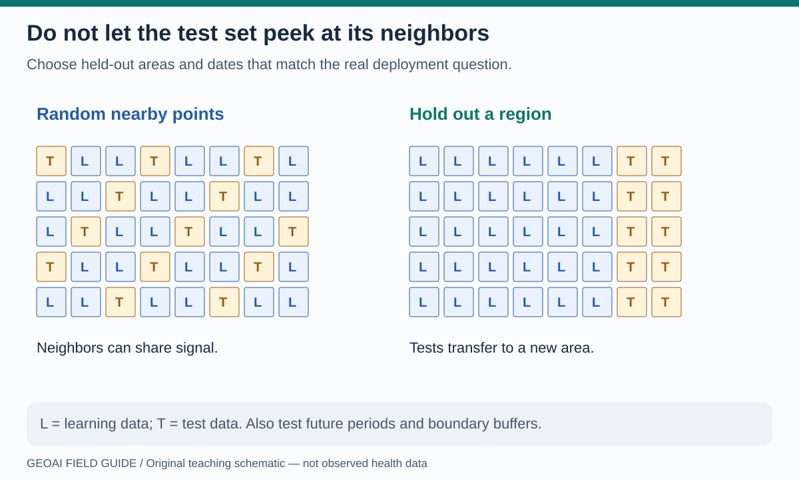
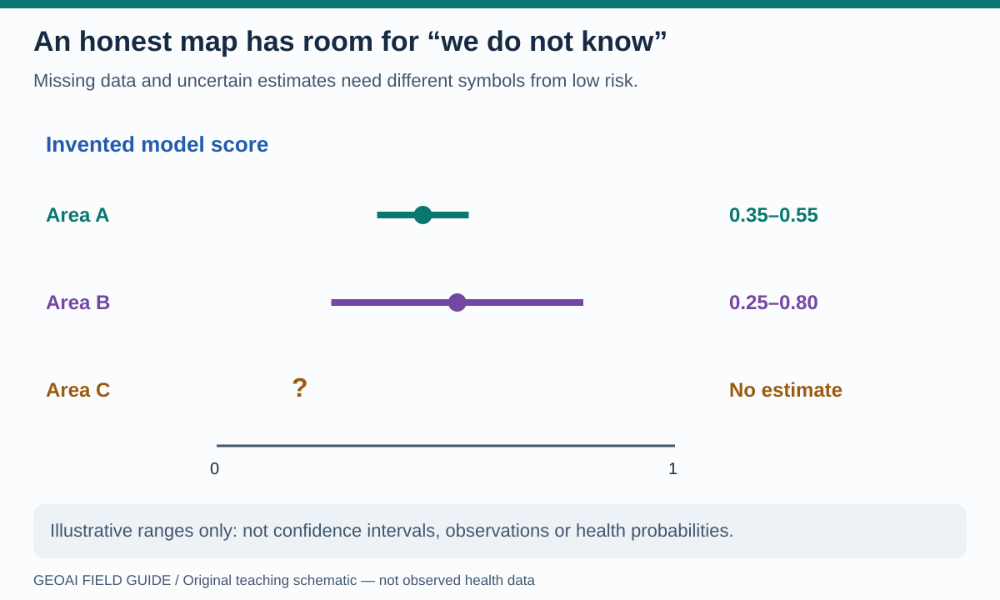

# How GeoAI works: from code to a decision

A useful starting question is small and testable: *“Which areas might lose access to a service if a connection fails?”* Start with a decision, not a model name. The following workflow is a teaching design for this book, not a deployed health system.

## The six-step loop

**Read the picture:** steps 1–3 decide what the model can meaningfully see. Steps 5–6 decide whether its output deserves to influence action. Revisit earlier steps when evidence is missing or performance changes. The loop is incomplete if nobody owns the decision or measures the result.

| Step | Python idea a beginner will encounter | Question to ask |
|---|---|---|
| Load | `get_json`, `read_csv`, arrays | Where did the data come from? What if access fails? |
| Prepare | `merge`, `groupby`, coordinate transformation | Are units, dates, boundaries and join keys compatible? |
| Describe | Area, density, RGB values, graph measures | What does each feature measure, and what is missing? |
| Learn or calculate | `fit_predict`, similarity, shortest paths | Is this a fitted model, a rule or a spatial algorithm? |
| Inspect | A plot, map, mask or error table | Is the result plausible, uncertain, biased or out of scope? |
| Communicate | Export a recipe, figure or evidence table | Can another person reproduce and challenge the claim? |

These are reading landmarks, not one runnable code cell. See the [Python learning guide](../learning-guide.md) for syntax and each notebook's explanation before the corresponding code.

## Turning a map into model inputs

**Read the picture:** a satellite image is an array, but without coordinates and resolution it cannot tell you an area on Earth. A road graph needs meaningful edge weights; a number called `population` needs a reference year and a denominator definition.

In [lab 02](../notebooks/02_census_geoai_counties.ipynb), county attributes become numeric features. Scaling helps avoid a large-unit feature dominating similarity. K-Means assigns groups in **feature space**, not necessarily adjoining geographic regions. Remapping those assignments helps inspect their spatial pattern; cluster numbers are names, not an ordered severity score. Change the number of clusters and explain what changes before choosing a preferred picture.

In [lab 03](../notebooks/03_earth_observation_geoai.ipynb), the learned features are small-image RGB values. Similar colors form groups. A cluster is not automatically “water,” “urban” or “forest”: those names need suitable evidence. The display layers and the Python-side image are distinct inputs.

## Testing what happens somewhere else

**Read the picture:** if training and test locations share the same local signal, a random split can answer an easier question than deployment in a new district. Choose spatial groups, separation buffers and future periods to match the intended use. Group and time split tools can help, but do not decide appropriate geographic boundaries for you. Fit preprocessing on training data only; keep final test observations out of model and threshold selection. See [scikit-learn's cross-validation guide](https://scikit-learn.org/stable/modules/cross_validation.html) and [research comparing spatial cross-validation strategies](https://arxiv.org/abs/2303.07334).

The existing clustering lessons are exploratory, not validated health predictors. Before adapting one, compare against a simple baseline: last season's pattern, an existing program rule, or a transparent geographic calculation. For clustering, inspect stability under changes in features and settings; a visually pleasing map is not a performance metric.

## Show uncertainty without inventing precision

**Read the picture:** the ranges are purely illustrative, not computed confidence intervals. They show why a single color or rank may hide weak evidence. A measured range, prediction interval and sensitivity envelope answer different questions and should be labeled differently. An anomaly score is not a disease probability.

Try [lab 13](../notebooks/13_astra_vision_change.ipynb): known synthetic change makes false detections and misses inspectable. Then try [lab 15](../notebooks/15_astra_network_accessibility.ipynb): changing assumed speeds gives a sensitivity envelope, not a statistically estimated confidence interval. Ask how your conclusion changes when the assumption changes.

## Before a real program pilot

Write down the intended population and decision; the permitted data and sharing boundary; the baseline; the spatial/time validation plan; an equity check; and a condition under which the tool should not be used. A pilot should measure whether the decision improves a relevant outcome, not merely whether the model runs. Health AI governance also requires accountability, transparency and protection of human interests; the [WHO ethics and governance guidance](https://www.who.int/publications/i/item/9789240029200) provides a broader framework.

**Try a teach-back:** would you trust a high score from an area with no recent observations? What symbol and explanatory text should its map show?

**Next:** [Find the notebook that demonstrates your method](notebook-atlas.md).
