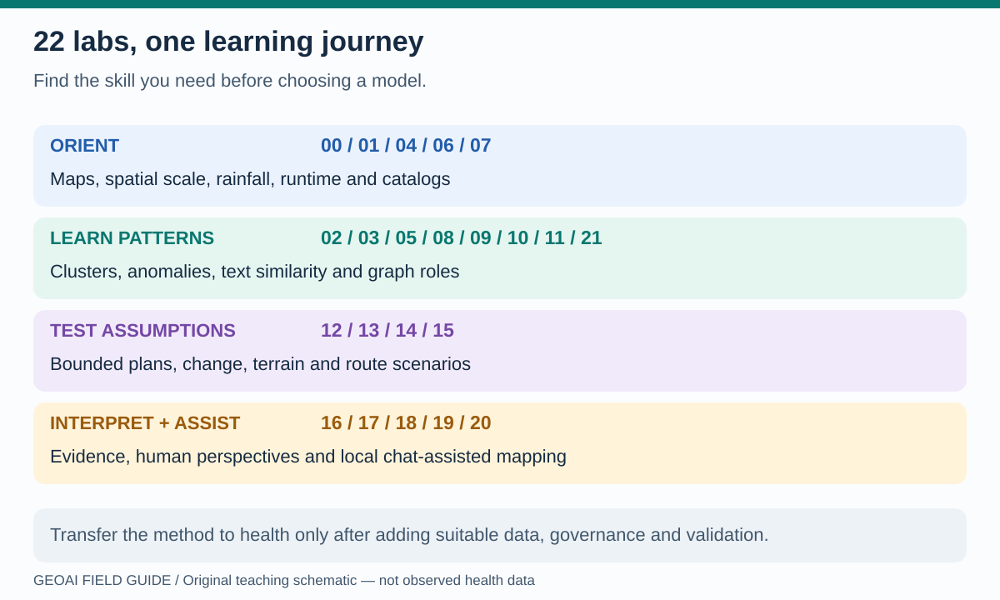

# What do all 18 notebooks actually demonstrate?

Use this atlas to connect a program question to a method, then read the notebook's code guides. **The potential health uses below are transfer exercises, not health analyses already performed by these notebooks.** Adding disease names to a map does not validate a health application.

**Read the picture:** this is a learning sequence, not a ranking of sophistication. A transparent route calculation can be more useful than an unsuitable AI model. The model-fitting labs use small browser-compatible methods; the optional external-model path is separate.

## Spatial and data foundations

| Notebook | What actually runs | Possible health transfer; missing evidence |
|---|---|---|
| [00 · GeoLibre quickstart](../notebooks/00_geolibre_quickstart.ipynb) | Vector and raster layers in a browser-safe map; no fitted model | Explain where services and hazards overlap; verify service status and layer dates |
| [01 · WorldPop + H3](../notebooks/01_worldpop_h3.ipynb) | Streamed population layer plus hex indexing and neighborhood geometry; no fitted model | Discuss denominators and aggregation scale; an H3 cell does not automatically contain a population count |
| [04 · CHIRPS climate](../notebooks/04_chirps_climate.ipynb) | Real daily rainfall layer plus a separate synthetic rolling-rainfall exercise | Learn daily variability and rolling totals; need an observed time series and health data for warning models |
| [06 · Compatibility](../notebooks/06_geoai_compatibility.ipynb) | Package checks and browser/full-Python boundary; no model | Choose a feasible teaching or production environment; this is not a security certification |
| [07 · STAC catalogs](../notebooks/07_stac_browser_catalogs.ipynb) | Catalog links, guarded discovery and statuses; browser API probing is deliberately limited | Locate imagery and population metadata; a catalog search is neither pixel analysis nor guaranteed browser access |

## Models that learn patterns in the browser

| Notebook | What actually runs | Possible health transfer; missing evidence |
|---|---|---|
| [02 · Census counties](../notebooks/02_census_geoai_counties.ipynb) | Derived/scaled county features and K-Means | Compare area profiles; clusters are not deprivation diagnoses or causal explanations |
| [03 · Earth observation](../notebooks/03_earth_observation_geoai.ipynb) | MiniBatchKMeans on a small NASA GIBS RGB image; separate streamed EO layers | Understand image features; need suitable bands, reference labels and validation for environmental classes |
| [05 · Earthquakes + H3](../notebooks/05_h3_earthquake_geoai.ipynb) | H3 event aggregates and Isolation Forest | Learn unusual-pattern triage; this is not earthquake prediction or a disease alert model |
| [08 · STAC footprints](../notebooks/08_stac_geoai_footprints.ipynb) | Metadata clustering when enough items are returned; mapped footprints | Select comparable acquisitions; sparse results may skip fitting, and footprints are not pixel classifications |
| [09 · Demo recommender](../notebooks/09_geolibre_demo_recommender.ipynb) | TF-IDF, text clustering, cosine similarity and a 2D projection | Retrieve relevant workflow examples; similarity is not correctness, and plot coordinates are not geography |
| [10 · Sister Cities](../notebooks/10_sister_cities_graph_geoai.ipynb) | Graph features, clustering and anomaly detection on partnership links | Learn network roles; real referral networks require new data, and partnerships are not contact or mobility records |
| [11 · Wildfire triage](../notebooks/11_wildfire_stac_triage.ipynb) | Perimeter-feature anomalies, STAC discovery, a hand-weighted ranking and acquisition grouping | Practice event/imagery review; not a validated burn-severity or health-impact model |

## Synthetic experiments and interpretation

| Notebook | What actually runs | Possible health transfer; missing evidence |
|---|---|---|
| [12 · Spatial copilot](../notebooks/12_astra_spatial_copilot.ipynb) | A hand-authored bounded plan filters synthetic temperature/canopy/population cells | Learn auditable selection and threshold sensitivity; not a trained heat model or a default AI API call |
| [13 · Vision change](../notebooks/13_astra_vision_change.ipynb) | A threshold on synthetic before/after pixels, a known cloud mask and known truth | Learn change masks and errors; real imagery needs alignment, cloud detection and independent truth |
| [14 · Terrain 3D](../notebooks/14_astra_terrain_3d.ipynb) | An analytic invented surface, derivatives, profiles and 3D views | Learn elevation, slope and exaggeration; not a real-city DEM or hydrodynamic flood model |
| [15 · Network accessibility](../notebooks/15_astra_network_accessibility.ipynb) | Shortest paths on an invented grid, bridge closure and speed sensitivity | Test access assumptions; node coverage is not population coverage or verified care delivery |
| [16 · SaTScan / sea-level rise](../notebooks/16_sea_level_rise_sat_scan_geoai.ipynb) | Existing aggregate PBIX-derived cluster/scenario results, charts, 2D/3D views and narrative | Interpret report evidence; no new SaTScan or fitted AI model, and 3D relative risk is not water depth |
| [17 · Rewiring global health](../notebooks/17_rewiring_global_health_six_hats.ipynb) | Authored perspective prompts, tables and report summaries | Facilitate accountable discussion; these are not seven autonomous agents or independent model validation |

Labs 12–15 also support optional exported model requests through a separate full-Python runner. Default offline examples are hand-authored; real responses, if requested and imported, must be examined as external-model outputs.

## Choose a small learning route

- **PEPFAR, HIV or TB:** 01 → 02 → 15 → 17. Understand denominators, compare profiles, test access, discuss action. Read [HIV/TB use cases](hiv-tb.md).
- **Polio, malaria or outbreak operations:** 07 → 08 → 05 → 15. Discover evidence, inspect metadata, learn anomaly triage and routes. Read [outbreak use cases](outbreaks.md).
- **Heat, flood or environmental exposure:** 03 → 04 → 12 → 14 → 16. Distinguish pixels, time series, rules, terrain and statistical results. Read [climate–health pathways](climate-health.md).
- **Decision makers:** this atlas → 16 → 17. Ask what is observed, modeled, assumed and missing. Read [responsible program decisions](climate-society.md).

For every notebook, predict one result, run the relevant cells, change one assumption, and explain what changed. The [captioned visual learning library](https://jltobias.github.io/JupyterLite-GeoLibre-GeoAI/lite/files/assets/learning/index.html) provides short videos, transcripts and teaching cartoons without launching Python.
