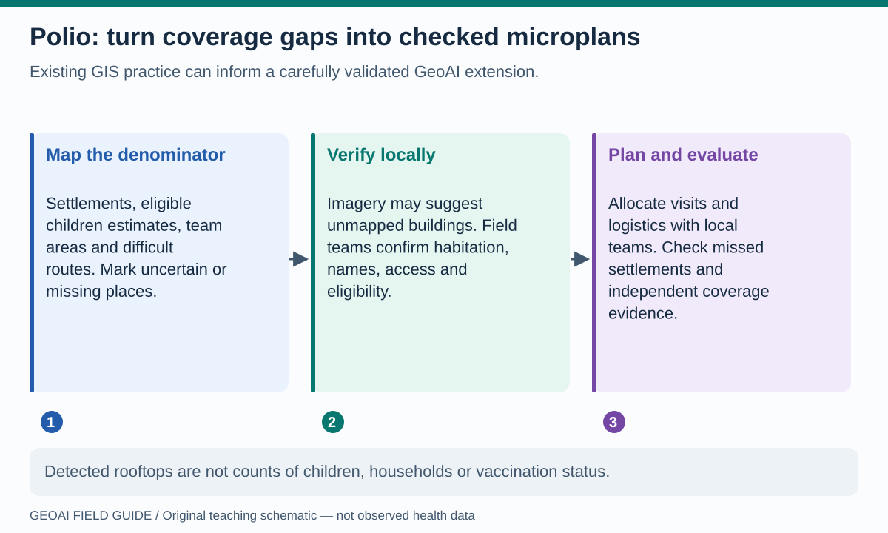
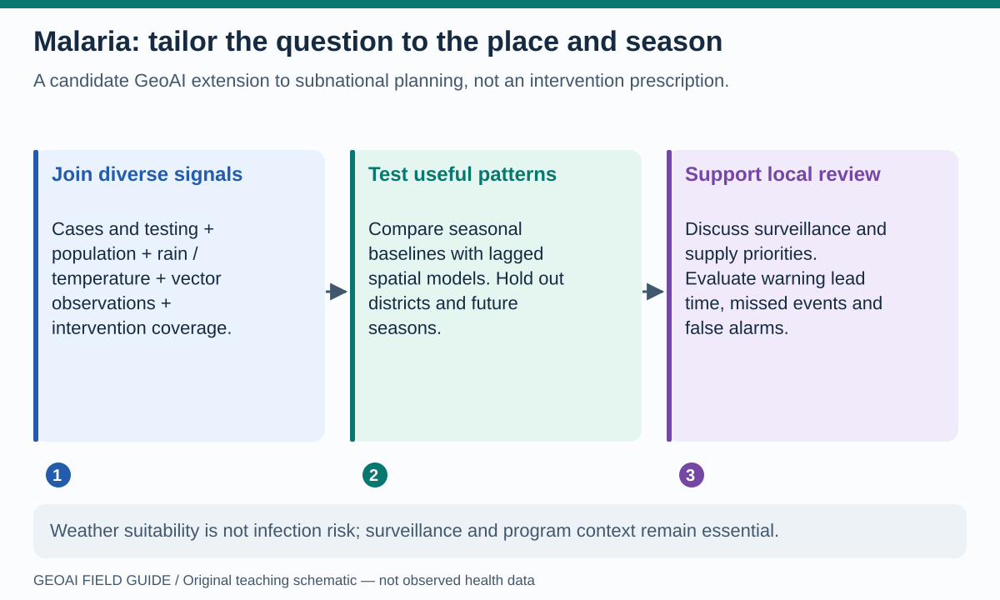
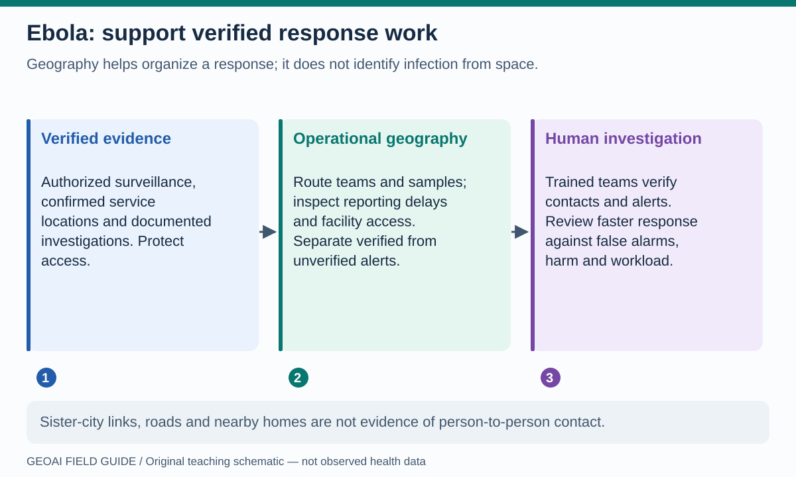
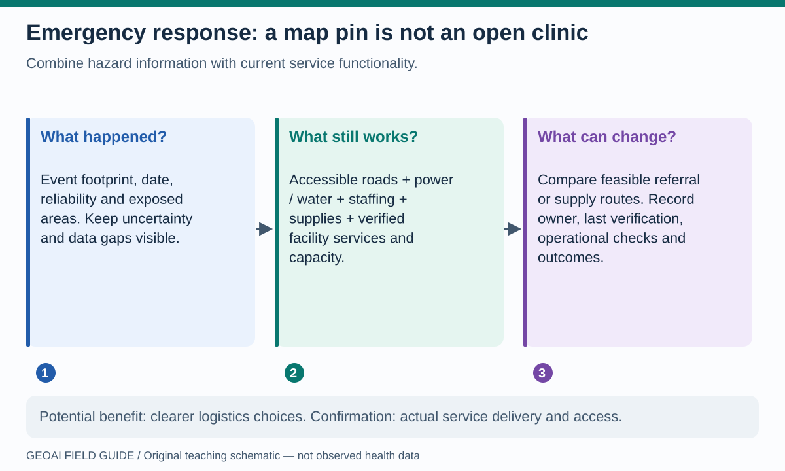

# GeoAI for disease programs and emergency response

Different diseases require different evidence. A settlement map can support vaccination logistics; it cannot identify an Ebola contact. The common opportunity is to combine geography with reliable surveillance and service information, then evaluate whether a decision improves. The workflows below are **proposed teaching transfers**, not operational recommendations for an active outbreak.

## Polio: reach places a plan may have missed

**Read the picture:** imagery can suggest that a settlement is absent from a planning map. It cannot tell you how many eligible children are present, whether they were vaccinated, or why a household was missed. Local verification is part of the method, not an optional afterthought. [GPEI's microplanning explanation](https://polioeradication.org/news/the-microplanning-puzzle-planning-for-an-effective-vaccination-campaign/) describes the practical role of maps, local knowledge, team areas and logistics.

**Notebook bridge:** [01 · WorldPop/H3](../notebooks/01_worldpop_h3.ipynb) teaches population surfaces and scale; [03 · image clustering](../notebooks/03_earth_observation_geoai.ipynb) introduces pixels; [15 · routes](../notebooks/15_astra_network_accessibility.ipynb) tests barriers. None detects real missed children. A building-detection extension would require suitable imagery, reference annotations, error checks and a separate population-estimation process.

**Benefit to test:** fewer missed settlements and feasible team workloads. Evaluate against independently checked settlement lists and coverage evidence, including mobile and difficult-to-reach populations. Do not equate GPS traces of teams with verified vaccination.

## Malaria: combine place, season and program context

**Read the picture:** rainfall alone is insufficient. Testing patterns, vector observations, population, prevention coverage and care access can all change the interpretation of reported cases. [WHO's subnational tailoring manual](https://www.who.int/publications/b/81075) describes a country-owned process for using local data and contextual evidence in intervention planning; it does not endorse the toy workflows here.

**Notebook bridge:** [04 · CHIRPS](../notebooks/04_chirps_climate.ipynb) teaches a rainfall layer and a separate invented series; [08 · STAC](../notebooks/08_stac_geoai_footprints.ipynb) teaches acquisition metadata; [05 · anomaly detection](../notebooks/05_h3_earthquake_geoai.ipynb) shows an unusual-pattern method on earthquake data. A malaria extension needs real aligned time series, appropriate lags, case definitions, testing and intervention data, and validation on later seasons and held-out areas.

**Benefit to test:** useful warning lead time or clearer surveillance priorities. Compare a learned model with a seasonal baseline; count false alerts and missed events, not only overall accuracy. Environmental suitability does not equal transmission, and clustering places does not prescribe an intervention package.

## Ebola: verified surveillance before geographic inference

**Read the picture:** routing a team and determining a person's contacts are different tasks. A map may help organize response work, but contact identification requires documented investigation by authorized teams. See [WHO's contact-tracing guidance](https://www.who.int/publications/i/item/WHO-EVD-Guidance-Contact-15.1).

**Notebook bridge:** [15 · accessibility](../notebooks/15_astra_network_accessibility.ipynb) can teach operational routing and [11 · event/imagery triage](../notebooks/11_wildfire_stac_triage.ipynb) can teach evidence review on another hazard. Neither identifies cases, contacts or transmission chains. The Sister Cities graph is especially unsuitable as a substitute for contact data.

**Benefit to test:** faster verified alert investigation, reliable sample transport or improved team access. Evaluate completeness, reporting delays and false alarms alongside speed. Do not publish line lists, contact locations or identifiable movement histories in this public browser environment.

## Emergency and outbreak response: ask which services still work

**Read the picture:** a clinic symbol can remain on a map after its power, water, staffing or services have failed. Availability and functionality need recent verification. [WHO HeRAMS](https://www.who.int/initiatives/herams) focuses on information about health resources and services down to service-delivery points; this illustrates the kind of operational evidence a hazard-only map lacks.

**Notebook bridge:** use [07 · catalogs](../notebooks/07_stac_browser_catalogs.ipynb) for discovery, [11 · triage](../notebooks/11_wildfire_stac_triage.ipynb) for a review workflow, [13 · change](../notebooks/13_astra_vision_change.ipynb) for error concepts, and [15 · routes](../notebooks/15_astra_network_accessibility.ipynb) for a connection failure. Real damage mapping needs validated observations; synthetic pixel change is not a building-damage assessment.

**Benefit to test:** feasible resource or referral choices with clearer evidence. Record the source time, last verification, decision owner, uncertainty and a fallback when communications fail. Compare planned access with actual service delivery; a faster route on paper is not proof of better care.

## One exercise across all four examples

Choose a diagram and label each input **observed**, **estimated**, **assumed** or **missing**. Then identify one failure that a model score would not reveal. A polio team may know a settlement by another name; a malaria increase may reflect more testing; an alert may be duplicated; a clinic may lack the required service. Ask who can verify the missing fact before acting.

**Next:** [Climate–health pathways](climate-health.md).
