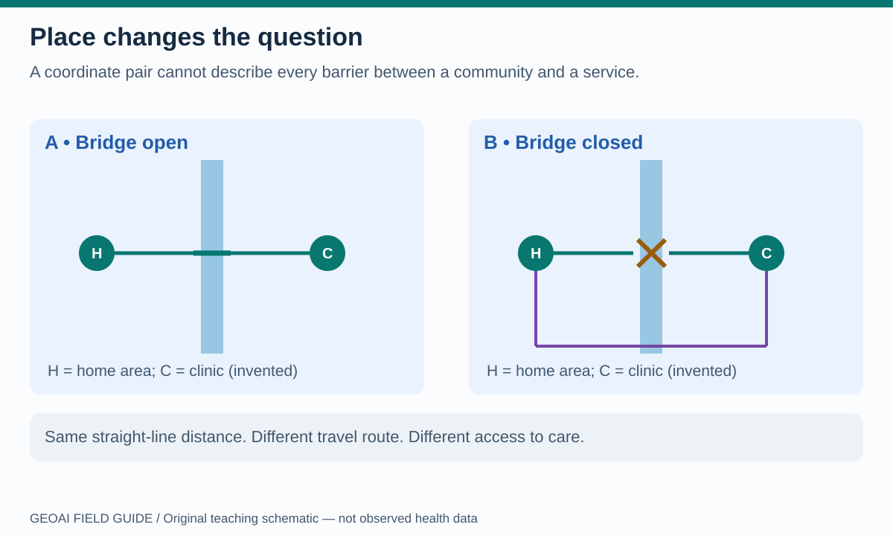
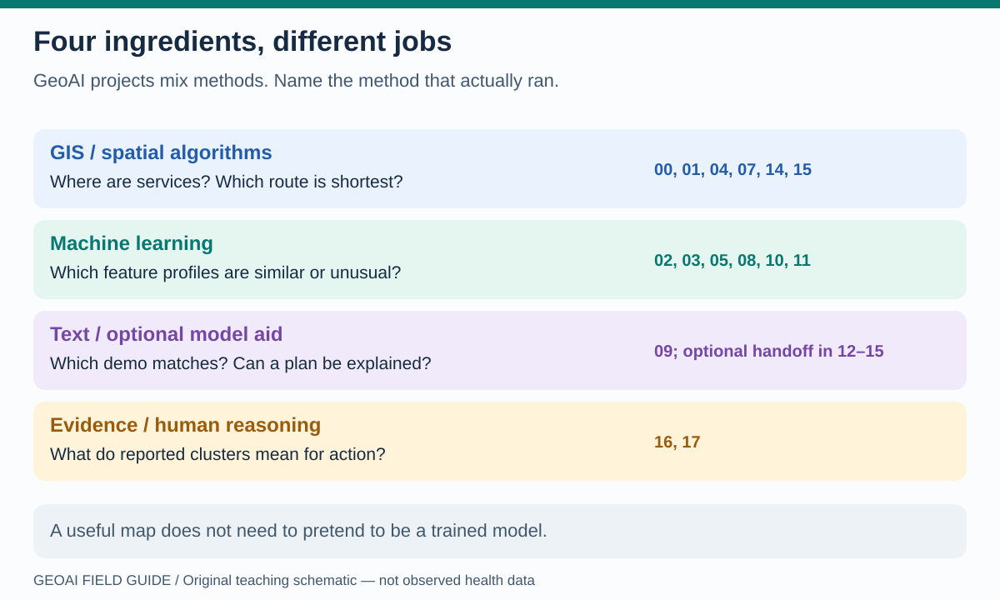
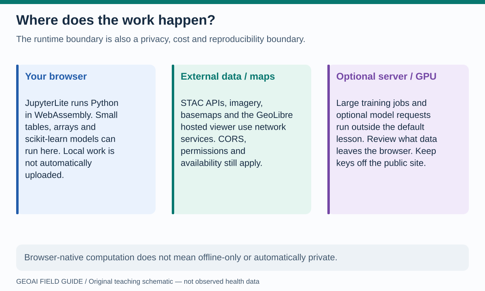
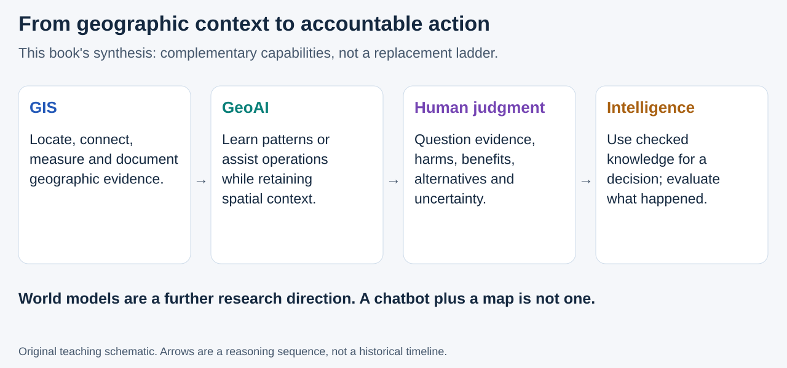
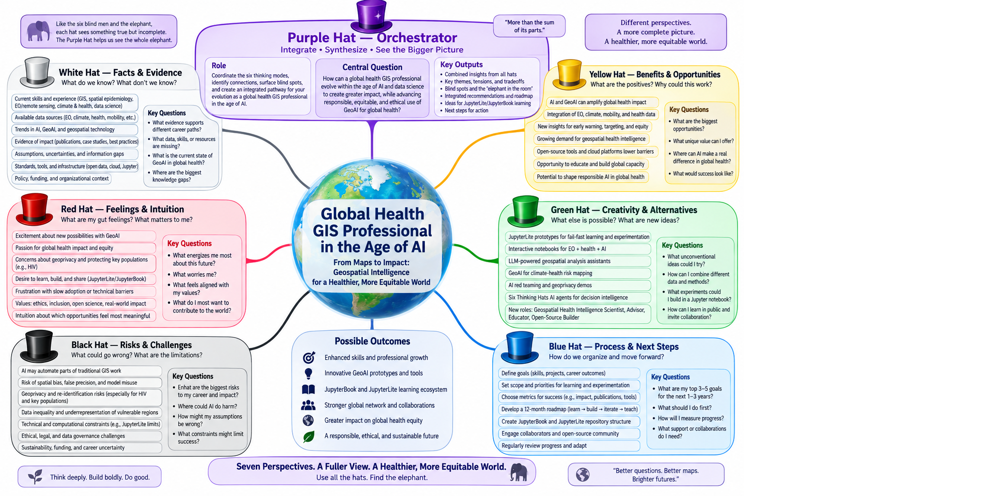

# What is GeoAI?

Looking for the tools rather than the methods? [What is JupyterLite?](../platforms/jupyterlite.md) introduces the browser workbench; [What is GeoLibre?](../platforms/geolibre.md) introduces the mapping workspace. GeoAI is the analytical idea, not another name for either application.

**GeoAI uses artificial-intelligence methods with geographic data and reasoning.** It asks not only “what pattern is present?” but also “where, when, at what scale, and connected to what?” Geography changes the inputs, interpretation and testing of a model. This introduction follows the broad definition used in [USGS GeoAI research](https://www.usgs.gov/publications/geoai-us-geological-survey-topographic-mapping).

This visual field guide answers the questions behind the code. Start here without installing Python or running a notebook. All 24 new diagrams are original teaching schematics, not measured health outcomes; the surrounding text provides their reading guide. Open any diagram in a new tab to enlarge it.

## Is GeoAI different from “traditional AI”?

**Read the picture:** the inner box is not a rival to the outer box. GeoAI can use familiar AI methods, including machine learning, computer vision and language models. The geographic context makes the application spatial: neighboring observations may resemble one another, roads connect some places but not others, and the same pattern can mean different things at different scales. GIS contributes spatial operations; health professionals and communities supply knowledge that is not contained in coordinates.

| Ordinary example | Geographic version | What geography adds |
|---|---|---|
| Group records with similar numeric values | Group districts by selected environmental or service indicators | Boundaries, rates, spatial scale and regional interpretation |
| Classify an image | Identify features in georeferenced satellite imagery | Pixel size, acquisition date, cloud masks and positional accuracy |
| Flag an unusual record | Flag an unusual place–time service pattern | Local baseline, reporting completeness and spatial/time validation |
| Summarize text | Explain verified evidence linked to places | Traceable geographic sources and limits on unsupported spatial claims |

“Traditional AI” is a broad phrase, not a precise opposing category. A standard K-Means algorithm can be part of GeoAI when applied to geospatial features. A chatbot mentioning a city is not automatically doing spatial analysis. The **field of GeoAI** is also broader than the particular **`geoai-py` software package**: these browser lessons teach selected methods, not the entire package's deep-learning stack.

## Why does place matter?

**Read the picture:** home area H and clinic C did not move. Closing the bridge changes the route, not their coordinates. A model using only straight-line distance might miss a barrier to care. [Lab 15](../notebooks/15_astra_network_accessibility.ipynb) lets you change a bridge in an invented network and compare travel times. That calculation is a spatial algorithm, not learned AI; it could become an input to a larger GeoAI workflow.

Three other geographic traps deserve names:

- **Spatial dependence:** nearby places may share conditions. Testing on near-neighbors of training data can exaggerate performance elsewhere.
- **Scale and boundaries:** an average for a large district can hide a small underserved area; regrouping observations can change a pattern.
- **Ecological fallacy:** an area-level association does not establish an individual's status, behavior or risk.

## Which parts of these notebooks are actually AI?

**Read the picture:** a project can benefit from all four families. Only some steps learn from data. For example, `fit_predict(...)` in a clustering lab learns group assignments from features; a threshold such as `temperature >= 30` applies a rule chosen by its author. A map renders the result of either operation but does not turn a rule into a trained model.

The [22-notebook atlas](notebook-atlas.md) identifies exactly what each lesson does. For an introductory presentation, try [five minutes: from John Snow’s map to GeoAI](../presentations/cholera-five-minutes.md), then [run the historical-data clustering lesson](../notebooks/21_cholera_geoai_first_steps.ipynb). It contrasts a map, an actual fitted model and human investigation without inferring a cause from a cluster. In particular, labs 12–15 run deterministic, synthetic exercises by default; optional external-model requests are separate. Lab 16 visualizes pre-existing SaTScan report results. Lab 17 structures human discussion. Neither performs a new AI analysis of disease burden.

## What Esri's overview adds

Esri's [GeoAI overview](https://www.esri.com/en-us/capabilities/geoai/overview) emphasizes two complementary tasks: **extracting geographic information** from sources such as imagery, video, point clouds and text, and **using spatial machine learning** to investigate patterns or make predictions. It also describes starting with pretrained models, adapting models, and integrating other models into ArcGIS workflows. These are Esri platform examples, not a requirement to use ArcGIS for GeoAI.

The connections below are **this book's teaching interpretation**, not Esri's documentation or evaluation of these notebooks:

| A beginner's question | Explore in this book | Keep the claim within the evidence |
|---|---|---|
| How can an image become information? | [Lab 03](../notebooks/03_earth_observation_geoai.ipynb) groups RGB pixels; [lab 13](../notebooks/13_astra_vision_change.ipynb) measures changes in invented images | Neither runs Esri's pretrained feature-extraction models; a color group is not a verified object label |
| What patterns can a model reveal? | [Lab 02](../notebooks/02_census_geoai_counties.ipynb) groups county profiles; [lab 05](../notebooks/05_h3_earthquake_geoai.ipynb) scores unusual earthquake profiles | Exploratory groups and anomaly scores are not validated forecasts |
| Could the result inform a decision? | [Lab 15](../notebooks/15_astra_network_accessibility.ipynb) compares routes after a bridge closure | This is a synthetic, deterministic accessibility exercise, not learned AI or measured health impact |

Esri presents automation, faster situational awareness and geographically informed decisions as organizational benefits. Treat those as **benefits to test**, not measured outcomes of these browser lessons. [Source: Esri's overview, value discussion](https://www.esri.com/en-us/capabilities/geoai/overview).

For a proposed health-program pilot, ask whether a workflow reduces review time **without increasing missed problems or unequal performance across places**. Compare with the current process and review errors with local practitioners. This is the book's suggested evaluation question; see [how GeoAI works](how-it-works.md) for validation and governance, not an Esri finding about a health program.

**Attribution:** ideas above are paraphrased from **Esri's GeoAI overview**, accessed **11 October 2026**; the [reference register](../references.md) provides the citation. No Esri graphics, videos or text passages are reproduced. This independent book is not affiliated with or endorsed by Esri, and the comparison does not add ArcGIS software or an Esri model to the notebooks.

(aws-geoai-perspective)=
## What AWS's overview adds

Amazon Web Services (AWS) describes GeoAI as combining geographically referenced information—such as coordinates, satellite imagery and demographic data—with AI methods to find patterns and support predictions. Its explanation emphasizes **location as context**, with applications in environmental monitoring, land planning, disaster response and infrastructure management. It places GIS, connected sensors (IoT), computer vision, machine learning and cloud computing within a wider technology ecosystem. [Source: AWS, *What Is Geospatial Artificial Intelligence?*](https://aws.amazon.com/what-is/geospatial-artificial-intelligence/).

**For a beginner:** ask both “What information describes this place?” and “What does the model actually learn from it?” This is **this book's teaching interpretation**, not an AWS evaluation of the notebooks:

| Browser example | What it demonstrates |
|---|---|
| **Locations:** [cholera lab 21](../notebooks/21_cholera_geoai_first_steps.ipynb) groups recorded death locations using DBSCAN | Coordinates and geographic distance enter the model. Revealing pumps adds context, not evidence of causation |
| **Images:** [Earth-observation lab 03](../notebooks/03_earth_observation_geoai.ipynb) groups RGB pixels from a small image | The model finds similar colors, not verified land-cover classes; interpretation needs additional evidence |
| **Access:** [network lab 15](../notebooks/15_astra_network_accessibility.ipynb) compares routes in an invented network | This is deterministic spatial analysis, not fitted AI. A useful geographic decision does not always need AI |

**Methods are not deployment platforms.** Deep learning is one family of machine-learning methods, not a requirement for every GeoAI task. Cloud computing can support larger workloads, but **GeoAI does not require AWS or cloud execution**. Lab 21 demonstrates a small, non-neural-network model fitted in the browser. Loading the site and packages, or opening an optional hosted map, still involves network services; see the runtime diagram below.

**A global-health question to explore:** could geographic evidence help a team investigate disrupted access to services after a flood? This is our proposed teaching application, not a result reported by AWS or demonstrated by these notebooks. An operational pilot would need current hazard, population, road and service data, local review, privacy safeguards and validation against an existing planning approach. See [how GeoAI works](how-it-works.md) and [climate–health pathways](climate-health.md).

**Attribution:** the opening paragraph paraphrases **Amazon Web Services' overview**, accessed **12 October 2026**; see the [reference register](../references.md). No AWS graphics, videos or text passages are reproduced. This book is **not affiliated with or endorsed by AWS**. The notebook comparisons are ours; no AWS account, SDK or service dependency is added.

## Why demonstrate this in a browser?

**Read the picture:** JupyterLite makes small, inspectable experiments available without a local Python installation. A novice can alter a feature, threshold or route and see the consequence. GeoLibre provides interactive geographic views through the browser adapter. Large model training is a different environment; browser memory, package compatibility, service availability and cross-origin access still constrain these lessons.

This is useful for teaching, prototyping and explaining assumptions to program colleagues. It is **not evidence that a prototype is ready for sensitive operational data**. External map services can receive requests and supplied layer content; an exported notebook can retain outputs. Use public or synthetic examples in this public site, never patient addresses, line lists, HIV status or credentials.

(toward-geospatial-intelligence)=
## Toward geospatial intelligence

**This book's framing:** GeoAI is part of the continuing convergence of GIS and AI toward useful **geospatial intelligence**—checked geographic knowledge that helps people understand a situation, choose an action and evaluate its consequences. This is a broad public-health teaching usage, not a claim to replace the established geospatial-intelligence profession or its specialized definitions. GIS remains essential; newer AI does not make coordinates, spatial operations, provenance or domain expertise obsolete.

**Read the picture:** the arrows describe a reasoning chain, not an inevitable historical ladder. A transparent spatial query can support an excellent decision without AI. Conversely, a sophisticated model can produce poor intelligence when its data, assumptions or interpretation are wrong. “Intelligence” here is not a synonym for an attractive map, autonomous agent, or confident answer.

Stanford HAI's **Zhang et al. (27 July 2026)** discuss *spatial intelligence* as understanding physical environments to guide action, and *world models* as one technical route involving representations that predict environmental change in response to actions. They emphasize the need to evaluate whether simulations are faithful enough for their intended use. That research/governance discussion is broader than georeferenced GIS and is **not interchangeable with GeoAI or geospatial intelligence**. [Stanford HAI, *The World Model and Spatial Intelligence Era: Governing AI Beyond Language*](https://hai.stanford.edu/policy/the-world-model-and-spatial-intelligence-era-governing-ai-beyond-language).

Our notebooks teach building blocks—not a learned world model. Lab 14's invented surface, lab 16's scenario charts and labs 18–20's local chat-assisted mapping must not be mistaken for a validated physical simulation. See [digital twins](../futures/digital-twins.md) for a separate explanation of maintaining and testing a representation of a real system.

**Read the picture:** your graphic puts a person, not an algorithm, at the center. White checks evidence; red records concerns; black examines harms; yellow identifies benefits to test; green proposes alternatives; blue organizes review; purple synthesizes without erasing disagreement. These are useful questions along the chain from maps to decisions, not proof that seven AI agents have validated a result. [Lab 17](../notebooks/17_rewiring_global_health_six_hats.ipynb) develops the discussion; [lab 20](../notebooks/20_ollama_evidence_review.ipynb) applies it to an assistant's output.

**Artwork attribution:** user-supplied *SIX-THINKING-HATS-GPT-output-example.png*, reproduced unchanged. Original designer/generation provenance has not been independently verified. The six-hat concept is associated with Edward de Bono; purple orchestration is this supplied artwork's extension, not an original seventh hat. No Stanford artwork is reproduced, and neither Stanford nor the source authors endorse this book's synthesis.

**Try the next step:** the [advanced Ollama/GeoLibre chapter](../advanced/ollama-assistant.md) connects natural-language requests to map operations while keeping model proposals, computed evidence and human approval distinct.

## A two-minute teach-back

Explain this sentence to a colleague: “We clustered geographic feature profiles, then mapped them.” What learned from data? What did the map add? What claim would go too far?

One reasonable answer: the clustering method learned similarity groups; the map showed their locations; the groups do not, by themselves, prove disease risk or the cause of a pattern.

**Next:** [How GeoAI works](how-it-works.md), then choose a program in [HIV and TB](hiv-tb.md), [outbreak response](outbreaks.md), or [climate and health](climate-health.md).
