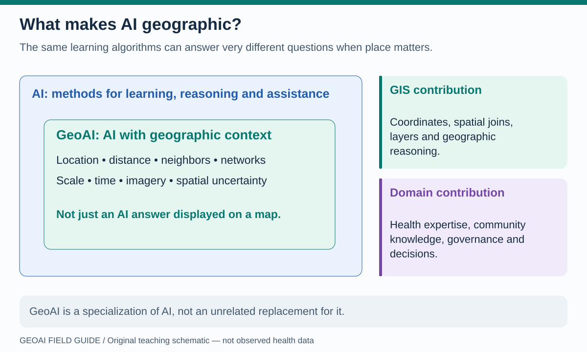
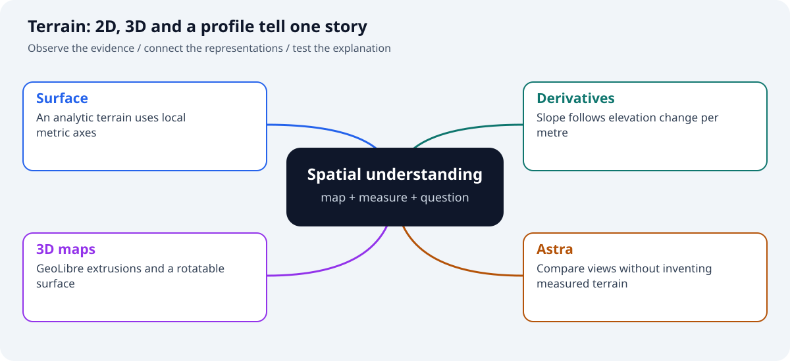

# GeoLibre + GeoAI in JupyterLite

This book is a set of **live, browser-native geospatial labs**. Each notebook chapter can be read as documentation or launched into a writable JupyterLite session with no local Python installation.

**Launch the lab:** [https://jltobias.github.io/JupyterLite-GeoLibre-GeoAI/lite/lab/index.html](https://jltobias.github.io/JupyterLite-GeoLibre-GeoAI/lite/lab/index.html)

**Presenting to beginners?** Start with [five minutes: from John Snow’s map to GeoAI](presentations/cholera-five-minutes.md). Map historical locations, fit geographic groups, reveal pumps and ask what evidence is missing. The chapter has presentation controls and static backups; [notebook 21](notebooks/21_cholera_geoai_first_steps.ipynb) performs the actual browser-based learning step.

## Start with the three ideas

| Your question | Plain-language answer | Illustrated introduction |
|---|---|---|
| What is JupyterLite? | The browser notebook workbench where you read and run Python | [JupyterLite: interface, runtime and saving your work](platforms/jupyterlite.md) |
| What is GeoLibre? | The mapping workspace used to explore geographic layers | [GeoLibre: maps, notebook integration and attribution](platforms/geolibre.md) |
| What is GeoAI? | Analytical methods that combine AI with geographic context | [GeoAI: methods, evidence and interpretation](geoai/primer.md) |

The two platform introductions use **seven graphics from James L. Tobias's July 10, 2026 presentation**, with reading guides, slide-level provenance and upstream credits. They distinguish historical screenshots from this repository's current browser workflow. GeoLibre is credited to **Qiusheng Wu and contributors**, with its recommended software citation and separate basemap/data acknowledgements.

## GeoAI for global health: a visual field guide

**What is GeoAI, how does it work, and why might a health program use it?** Start with the [illustrated GeoAI primer](geoai/primer.md): seven connected chapters and **24 new original diagrams**, with plain-language reading guides, notebook links, exercises and evidence boundaries. No Python kernel is needed to read them.

| Your question | Explore |
|---|---|
| How is GeoAI related to AI and GIS? | [What is GeoAI?](geoai/primer.md) |
| How do maps become model inputs and trustworthy results? | [How GeoAI works](geoai/how-it-works.md) |
| Which notebooks actually fit models? | [All 22 notebooks: method and interpretation atlas](geoai/notebook-atlas.md) |
| How could PEPFAR, HIV and TB programs benefit? | [Service continuity, denominators and referral networks](geoai/hiv-tb.md) |
| What about polio, malaria, Ebola and emergencies? | [Disease programs and response operations](geoai/outbreaks.md) |
| How do heat, floods, food, water and air connect to health? | [Climate–health pathways](geoai/climate-health.md) |
| What about vector shifts, migration, conflict and decisions? | [Social pathways and accountable interpretation](geoai/climate-society.md) |

Health applications are **potential extensions requiring appropriate data and validation**, not claims that these educational notebooks already predict disease or demonstrate program impact. The guide distinguishes observations, fitted models, deterministic rules, synthetic examples and existing report results.

## Discover data before choosing a model

Before choosing inputs, read [What is a STAC Browser?](platforms/stac-discovery.md). Follow a guided discovery exercise in the companion STAC Field Guide, inspect metadata with Python, and distinguish footprints, previews, downloads and GeoAI-ready evidence.

## Explore future directions

Two presentation-informed chapters connect the lessons to [digital twins and agent-based simulation](futures/digital-twins.md) and [map encryption and geoprivacy](futures/map-encryption.md). Four original visuals explain the model-update loop and privacy boundaries. These are potential extensions, not claims that this repository implements the separate Gaborone TB or encryption projects.

## Learn through the code

**New to Python or GeoAI?** Start with the [illustrated learning guide](learning-guide.md). Every notebook now includes an infographic, a short captioned video with a transcript, a teaching cartoon and a reading guide before each code cell. The [visual learning library](https://jltobias.github.io/JupyterLite-GeoLibre-GeoAI/lite/files/assets/learning/index.html) works without a Python kernel.

## Choose a notebook or visual

The [visual resource guide](visual-library.md) pairs **Read / Run / Watch / Infographic / Cartoon** links for all 22 notebooks. It also indexes 2D maps, 3D terrain, scenario animation, time-series charts and story-led interpretation, with clear evidence limits.

Start with **00 → 01 → 02** for maps and clustering; **03 → 13** for imagery; **14** for terrain; **12 → 15** for synthetic experiments with optional Astra assistance; **16** for report interpretation; and **17** for a facilitated discussion.

The enhanced labs pair maps with concept diagrams, charts or graphs, followed by an experiment that changes an assumption. Read the Book for diagrams and saved analytical figures; launch JupyterLite to manipulate data and create live GeoLibre maps. **Labs 12–15** use deliberately synthetic teaching data. **Lab 16** interprets a bundled PBIX-derived cluster summary, with saved charts and tables; **lab 17** supports human discussion. Neither is a new trained model or a validated health-impact study.

| Your question | Suggested path | What to compare |
|---|---|---|
| How does location become an analytical feature? | 00 → 01 → 02 → 12 | Coordinate map, H3 scale, feature space, selected cells |
| What changed in an image? | 03 → 08 → 13 | Appearance, footprints, masks, confusion counts |
| What does terrain shape reveal? | 00 → 14 | Contours, slopes, profile, 3D perspective |
| What happens when a connection disappears? | 12 → 15 | Graph topology, routes, cutoff and speed sensitivity |

Labs 12–15 run their analysis without an API key. Optional Astra requests are exported as JSON and sent by the repository's CPython runner; credentials stay outside the static browser site. Each lab explains how to import and inspect a real response. Hand-authored offline examples are labeled, and geospatial measurements are calculated in code.

## GeoLibre's JupyterLite boundary

The upstream `geolibre.Map` widget serves its bundled application from a kernel-side localhost HTTP server. That is appropriate in a normal Jupyter environment, but a Pyodide/WebAssembly kernel cannot bind the required TCP socket.

For that reason, the live labs use `geolibre_lite.LiteMap`, a small browser adapter included with the notebooks. It uses **GeoLibre's own project/layer builders** and the **GeoLibre hosted viewer's embed/postMessage protocol**, so GeoJSON, COG, PMTiles and GeoLibre symbology are still represented as GeoLibre projects without attempting to start an OS-level server.

Use upstream `geolibre.Map` directly when running the notebooks in a full CPython/Jupyter environment with a local server or supported Jupyter proxy.

## A practical interpretation of “GeoAI in JupyterLite”

The full `geoai-py` package is designed for advanced workflows including deep-learning segmentation, detection, classification, change detection, and model training. Its dependency graph includes PyTorch and TorchGeo. JupyterLite runs CPython compiled to WebAssembly through Pyodide, so not every native/GPU dependency is available.

These labs therefore use the **browser-native subset of the GeoAI workflow**: cloud data discovery, spatial feature engineering, H3 indexing, raster processing, scikit-learn modeling, anomaly detection, and interactive mapping in GeoLibre. The Earth-observation lab keeps Major TOM COGs in GeoLibre but uses NASA GIBS JPEG imagery for Python-side clustering so Pyodide does not depend on a missing GDAL ZSTD codec. The compatibility chapter shows where to hand the same data and concepts to full GeoAI on a desktop, cloud VM, Binder/Hub, or GPU notebook.

## Data ethics and reproducibility

The notebooks use public data and avoid hidden credentials. All sources, licenses, fixed example dates, mirrors, and citation guidance are collected in the repository's `DATA_SOURCES.md` and repeated in the relevant lab.
