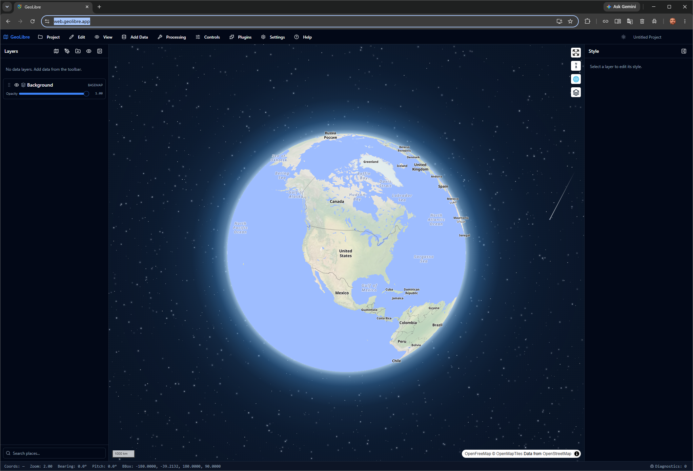
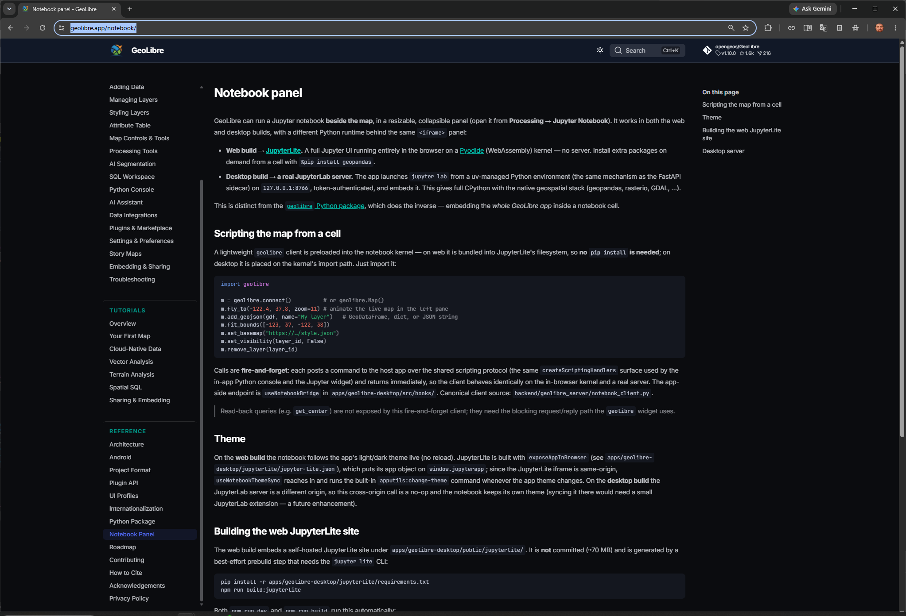
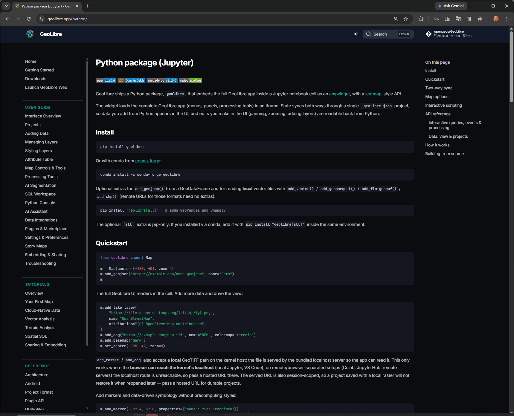
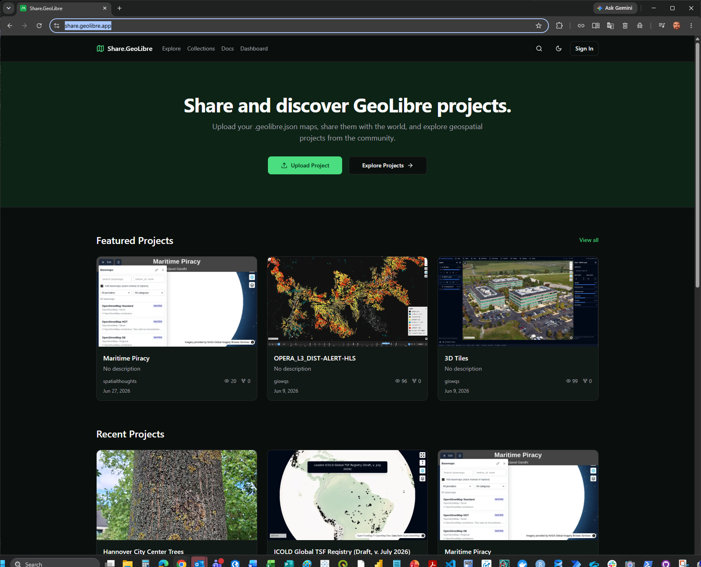

# What is GeoLibre?

**GeoLibre is an open-source geographic information system (GIS) for working with maps and spatial data.** A GIS connects records to locations so that you can inspect layers, compare places and communicate geographic evidence. GeoLibre provides a graphical workspace, with web and other deployment options and Python integration. It is developed by **Qiusheng Wu and contributors**, not by this notebook repository. See the [official project](https://geolibre.app/) and [source repository](https://github.com/opengeos/GeoLibre).

In these lessons, **Python prepares or analyzes data; GeoLibre displays the resulting spatial layers**. [JupyterLite](jupyterlite.md) provides the browser notebook environment. [GeoAI](../geoai/primer.md) describes methods that may learn from geographic data; a map is not automatically an AI model.

The four figures below are unchanged images from James L. Tobias's *JupyterLite: Geospatial Data Science and Global Health*, **10 July 2026**. The GeoLibre slides credit Wu's software. We repeat that attribution outside each image because presentation captions are separate from the embedded PNGs. Documentation links and the repository boundary below were checked on **11 October 2026**; current upstream features may differ from the pictured versions.

## Read the map workspace

*Figure GL1 — Presentation slide 38. GeoLibre Web interface by Qiusheng Wu and contributors; source: [GeoLibre Web](https://web.geolibre.app/). Visible basemap credits are retained: [OpenFreeMap](https://openfreemap.org/), [OpenMapTiles](https://openmaptiles.org/) and [OpenStreetMap contributors](https://www.openstreetmap.org/copyright). Presentation compilation: James L. Tobias. [Open full-size graphic](../assets/platforms/geolibre-workspace.png).*

**Read the picture:** the center is the geographic view, not a result by itself. The layer list tells you what has been added; styling controls determine how values appear. Pan and zoom change your view, not the underlying evidence. Keep the attribution area visible when sharing a map. The [interface guide](https://geolibre.app/user-guide/interface/) explains the controls.

The notebooks introduce four useful forms of spatial information:

| Term | Plain-language meaning | Example in this book |
|---|---|---|
| Vector / GeoJSON | Points, lines or areas with named attributes | Places in [lab 00](../notebooks/00_geolibre_quickstart.ipynb) |
| Raster / COG | A grid of values; a Cloud Optimized GeoTIFF supports fetching relevant parts | Rainfall imagery in [lab 04](../notebooks/04_chirps_climate.ipynb) |
| PMTiles | A tiled map archive designed for efficient access | WorldPop-on-H3 in [lab 01](../notebooks/01_worldpop_h3.ipynb) |
| STAC | A catalog standard describing geospatial items and their assets | Discovery and footprints in [labs 07](../notebooks/07_stac_browser_catalogs.ipynb) and [08](../notebooks/08_stac_geoai_footprints.ipynb) |

A STAC search result describes data; it is not necessarily the imagery itself. Each selected asset still has its own date, resolution, license and access requirements. The linked labs document the particular sources they use.

## GeoLibre, MapLibre and GeoAI are different things

| Name | Role | What not to infer |
|---|---|---|
| **GeoLibre** | The GIS application and its project/layer tools | Every function in the latest upstream app is available in this notebook adapter |
| **MapLibre GL JS** | One of the map-rendering components used by GeoLibre | MapLibre and GeoLibre are the same project |
| **GeoAI** | AI methods applied with geographic context and validation | A 3D map, layer toggle or attractive story automatically constitutes AI |

GeoLibre combines work from many projects; see its [dependency acknowledgements](https://geolibre.app/acknowledgements/). Its broader application includes [story-map authoring](https://geolibre.app/user-guide/storymaps/) and other capabilities beyond these notebooks. Those are upstream capabilities, not claims that every lesson here implements them.

## Two ways to put notebooks and maps together

*Figure GL2 — Presentation slide 39. GeoLibre documentation by Qiusheng Wu and contributors, from the [Notebook Panel guide](https://geolibre.app/notebook/) ([documentation source](https://github.com/opengeos/GeoLibre/blob/main/docs/notebook.md)). JupyterLite and JupyterLab are credited to their respective project contributors. Presentation compilation: James L. Tobias. [Open full-size graphic](../assets/platforms/geolibre-notebook-panel.png).*

**Read the picture:** this screenshot describes a notebook **inside the GeoLibre workspace**, beside an existing map. GeoLibre's web build uses JupyterLite for that panel; its desktop integration uses a full JupyterLab server. That arrangement differs from the lessons in this repository, which put a GeoLibre view **inside a JupyterLite notebook output**. See the [upstream notebook integration source](https://github.com/opengeos/GeoLibre/blob/main/docs/notebook.md).

*Figure GL3 — Presentation slide 41. [GeoLibre Python documentation](https://geolibre.app/python/) by Qiusheng Wu and contributors. The pictured v1.10.0 documentation is a historical snapshot, not a version recommendation or the API of this site's adapter. Presentation compilation: James L. Tobias. [Open full-size graphic](../assets/platforms/geolibre-python.png).*

**Read the picture:** the upstream Python package exposes a `Map` widget. In a full Python/Jupyter environment, that widget can serve its application through a kernel-side HTTP server. A standalone Pyodide kernel cannot start that operating-system TCP server. Do not copy the screenshot's full-Python widget setup into these browser lessons. See the [Python integration guide](https://geolibre.app/python/).

### What this repository actually runs

The notebooks use the repository's [`geolibre_lite.LiteMap` adapter](https://github.com/jltobias/JupyterLite-GeoLibre-GeoAI/blob/main/book/notebooks/geolibre_lite.py), often imported under the name `Map`. It uses GeoLibre's project/layer builders and sends the project to the hosted GeoLibre viewer through its [embedding interface](https://geolibre.app/user-guide/embedding/). It does not start a local Python web server.

| Part | Where it runs | Practical consequence |
|---|---|---|
| Notebook calculations | Pyodide kernel on the learner's device | Browser-compatible packages and device memory constrain analysis |
| Map display | Hosted `web.geolibre.app` loaded in an embedded browser frame | Internet access is needed; project content is passed into that external viewer |
| Basemaps and remote layers | Requests to the named data providers | Provider availability, permissions and browser-access policies still apply |

The setup in this repository pins **`geolibre==3.0.0`** for its Python-side builders. The independently hosted viewer can change. Record both your notebook revision and relevant software versions when reporting a result; do not treat the July screenshots, the pinned package and today's hosted application as identical versions. No notebook dependency is upgraded by these introductory chapters.

## From a gallery to a question you can test

*Figure GL4 — Presentation slide 42. [GeoLibre sharing gallery](https://share.geolibre.app/), platform by Qiusheng Wu and contributors. Visible project credits include **spatialthoughts** and **giswqs**; authors, basemaps and datasets retain their individual credits and terms. These projects were not produced by this book and are not health-program findings. Presentation compilation: James L. Tobias. [Open full-size graphic](../assets/platforms/geolibre-gallery.png).*

**Read the picture:** a gallery offers examples of what a map can communicate, not evidence that its method answers your question. [Lab 09](../notebooks/09_geolibre_demo_recommender.ipynb) explores similarity between demo descriptions; a recommendation is not a quality assessment or permission to reuse a dataset.

Try a three-stage learning exercise:

1. **Inspect a layer** in [lab 00](../notebooks/00_geolibre_quickstart.ipynb). Toggle it and locate its source. This is GIS exploration.
2. **Inspect a learned grouping** in [lab 02](../notebooks/02_census_geoai_counties.ipynb). Read which features enter K-Means. The algorithm forms groups; GeoLibre shows their geography. Group labels are not diagnoses or established risk categories.
3. **Change an assumption** in [lab 14](../notebooks/14_astra_terrain_3d.ipynb) or [lab 16](../notebooks/16_sea_level_rise_sat_scan_geoai.ipynb). Ask what a 3D height or animation represents. Lab 14 uses synthetic terrain; lab 16's statistical columns and scenarios are not simulated flood depths.

For global-health learning, this separation helps distinguish data, calculations and presentation. A proposed service-access map still needs appropriate population and service data, validation and local review. The [health field guide](../geoai/hiv-tb.md) explains those evidence boundaries. Do not put identifiable health records or credentials in shared map projects; review external destinations and the [GeoLibre privacy policy](https://geolibre.app/privacy/) before any sensitive use.

(geolibre-citation)=
## How to cite GeoLibre and these figures

Use the software's [recommended citation](https://geolibre.app/citation/):

> Wu, Q. (2026). *GeoLibre: A lightweight, cloud-native GIS platform for visualizing, exploring, and analyzing geospatial data.* Zenodo. [https://doi.org/10.5281/zenodo.20785400](https://doi.org/10.5281/zenodo.20785400).

This is the **concept DOI**, covering the project across releases. For reproducible research, also record the version you used and use its release-specific DOI when available. The upstream [`CITATION.cff`](https://github.com/opengeos/GeoLibre/blob/main/CITATION.cff) supplies citation metadata. GeoLibre's [MIT license](https://github.com/opengeos/GeoLibre/blob/main/LICENSE) credits **Copyright (c) 2026 Qiusheng Wu**; an unchanged copy of that notice is [included with these figures](../assets/platforms/GEOLIBRE-LICENSE.txt).

Presentation source: **Tobias, J. L. (2026, July 10). *JupyterLite: Geospatial Data Science and Global Health* [Presentation], slides 38, 39, 41 and 42.** The embedded images were extracted unchanged from the supplied PPTX and checked against the PDF; [provenance records](../assets/platforms/provenance.json) identify their original members and checksums.

Credit operates at several levels: **Tobias for the presentation, Wu and contributors for GeoLibre, other projects for their components, and providers for each dataset or basemap**. A software license does not replace data terms or grant a new license to logos, third-party gallery projects or the whole presentation. Keep those credits with any reused figure; do not imply endorsement by GeoLibre, its contributors or the data providers.

**Continue:** [What is GeoAI?](../geoai/primer.md) → [how the methods work](../geoai/how-it-works.md) → [the notebook atlas](../geoai/notebook-atlas.md).
