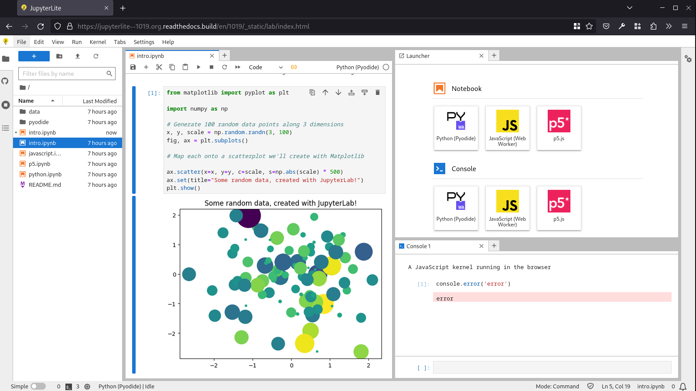
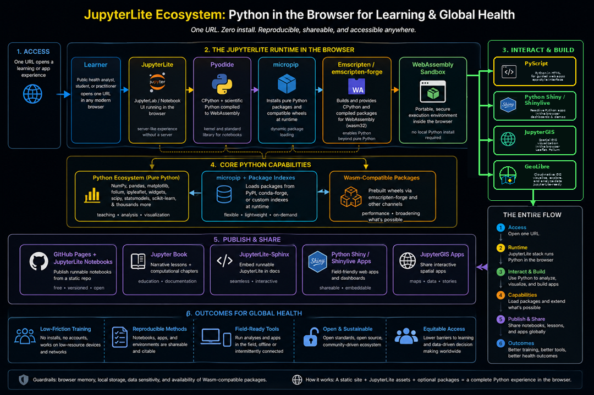
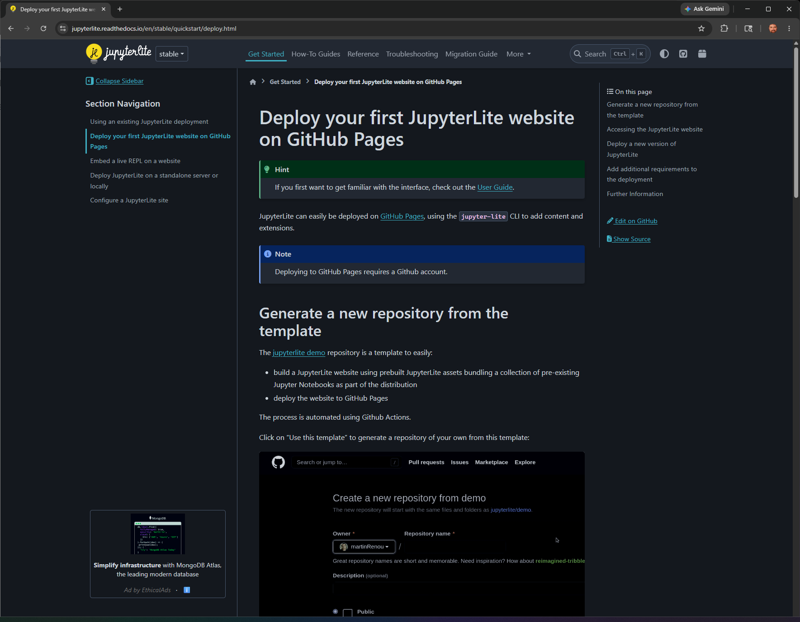

# What is JupyterLite?

**JupyterLite is a notebook workbench that runs in your web browser.** A notebook combines an explanation, executable code and its results in one document. In this site, Python runs through **Pyodide**, a WebAssembly-based Python runtime: you do not need to install desktop Python or connect to a separate Python server to start the lessons. The website still has to be hosted and its resources downloaded. See the [JupyterLite introduction](https://jupyterlite.readthedocs.io/en/stable/) and [Pyodide overview](https://pyodide.org/en/stable/).

Think of three complementary roles: **JupyterLite is the workbench; [GeoLibre](geolibre.md) is the mapping workspace; [GeoAI](../geoai/primer.md) describes the analytical methods.** Opening either application does not, by itself, perform AI.

The figures below come from James L. Tobias's *JupyterLite: Geospatial Data Science and Global Health*, presented **10 July 2026**. They are historical illustrations, not screenshots of this site's current interface. The accompanying explanations and official documentation links were checked on **11 October 2026**.

## Read the interface before running code



*Figure JL1 — Presentation slide 11. JupyterLite interface/documentation screenshot, credited to the JupyterLite Contributors. Source: [JupyterLite documentation](https://jupyterlite.readthedocs.io/en/stable/). Reproduced from the supplied presentation without changing the embedded image. [Open full-size graphic](../assets/platforms/jupyterlite-interface.png).*

**Read the picture:** the left panel holds files; the middle shows a notebook; a code cell produces the plot beneath it. The launcher on the right offers kernels available in that particular deployment, not a promise that every pictured language is installed here. This repository uses the **Python (Pyodide)** kernel.

| Word you will meet | Meaning in this book | What you do |
|---|---|---|
| Notebook (`.ipynb`) | A document containing ordered cells | Open a lab from the file browser |
| Markdown cell | An explanation, heading, image or link | Read it before running the next cell |
| Code cell | Instructions written in Python | Select it and press **Shift+Enter** |
| Kernel | The running interpreter that remembers variables | Wait for setup; restart for a fresh calculation |
| Output | A result such as a table, chart or map | Inspect it; an attractive output is not proof of accuracy |

JupyterLite resembles server-backed JupyterLab, but its computation and file storage have different boundaries. See [using a JupyterLite deployment](https://jupyterlite.readthedocs.io/en/stable/quickstart/using.html).

## How can Python run in a browser?



*Figure JL2 — Presentation slide 19. Ecosystem graphic supplied in Tobias's presentation; a separate illustrator and reuse license are not specified. Project names and logos remain those of their respective projects. This is a conceptual illustration, not a software dependency specification. [Open full-size graphic](../assets/platforms/jupyterlite-ecosystem.png).*

**Read the picture:** start with the learner at the top. A URL opens the notebook environment, a runtime executes Python, packages provide analytical tools, and results can become maps and learning materials. For this repository, the practical sequence is:

1. **Load the site:** your browser downloads the JupyterLite application and the published notebooks.
2. **Start Python:** the Pyodide kernel runs on your device using WebAssembly, a browser-supported execution format.
3. **Load compatible packages:** notebook setup installs or loads the tools needed by that lesson.
4. **Run and inspect:** Python computes tables or features; a chart or GeoLibre view makes the results visible.
5. **Keep your work:** download the notebook and any exported files you want to preserve.

```{admonition} Read this historical diagram with three corrections
:class: note

**Compiled packages are possible.** The diagram groups NumPy, pandas and SciPy under “Pure Python,” but these include compiled components. Pyodide supplies compatible WebAssembly builds; an arbitrary desktop binary wheel will not work. See [Pyodide](https://pyodide.org/en/stable/).

**Packaging routes are not one installation chain.** In this site's Pyodide kernel, `micropip` installs compatible Python packages. The diagram's Emscripten-forge branch represents another part of the browser-Python ecosystem, not a command that `micropip` automatically executes. JupyterLite also supports separately configured Xeus kernels. See [Pyodide package installation](https://jupyterlite.readthedocs.io/en/stable/howto/pyodide/packages.html) and [kernel choices](https://jupyterlite.readthedocs.io/en/stable/quickstart/using.html#kernels).

**Offline, secure and equitable are design goals, not automatic guarantees.** Live STAC services, package downloads and this site's hosted GeoLibre viewer need connectivity. Test any intended offline workflow explicitly, and consider device capacity, accessibility and data governance.
```

## Reading, running and publishing are different activities



*Figure JL3 — Presentation slide 17. Screenshot of [JupyterLite's GitHub Pages deployment guide](https://jupyterlite.readthedocs.io/en/stable/quickstart/deploy.html), credited to the JupyterLite Contributors; GitHub interface elements retain their respective ownership. An incidental advertisement in the original screenshot is not an endorsement by this book. [Open full-size graphic](../assets/platforms/jupyterlite-deployment.png).*

**Read the picture:** this is the publisher's side of the work. A repository stores source files; a build creates a static website; GitHub Pages serves it to readers. A learner can open the published lessons without a GitHub account. Updating the public lessons is a separate repository-and-deployment operation. See the [deployment guide](https://jupyterlite.readthedocs.io/en/stable/quickstart/deploy.html).

| Activity | Where it happens in this project | What changes |
|---|---|---|
| Read | This Jupyter Book | Nothing is executed by reading a page |
| Experiment | [The live JupyterLite lab](https://jltobias.github.io/JupyterLite-GeoLibre-GeoAI/lite/lab/index.html) | Your browser's editable notebook and kernel state |
| Preserve | Download action and notebook exports | Files you deliberately save to your device |
| Publish | Source repository, commit/push, Pages workflow | The shared book and the notebooks offered to future readers |

**Saving in JupyterLite does not commit or push to GitHub.** Browser storage can be cleared or evicted, so download important work. An existing browser copy may also hide a newly published version. Back up your edits before replacing that copy; do not clear browser storage as a first troubleshooting step. See [JupyterLite's content and local-copy behavior](https://jupyterlite.readthedocs.io/en/stable/howto/content/files.html).

## Your first safe experiment

Open [lab 00: GeoLibre quickstart](../notebooks/00_geolibre_quickstart.ipynb), then use its live launch link. Read each explanation, run the setup cells in order, and wait for the first map. Toggle one layer off and on. Ask: **did I change the data, the calculation, or only what is visible?** Changing visibility is mapping, not model training.

Next, use the [notebook method atlas](../geoai/notebook-atlas.md) to find a lesson that fits a model. Compare that learned result with a simple rule or a direct observation. The value of this workbench is that a learner can inspect and rerun the steps behind an answer; it does not establish that an answer is valid for a health program.

If a cell fails, distinguish the failure before changing the analysis:

- **`NameError`:** a required import or earlier setup cell may not have run. Restart the kernel and run from the top after saving your work.
- **Network/CORS error:** a remote service may be unreachable or may not permit browser requests. Increasing a timeout does not grant access. Read the fallback guidance in [lab 07](../notebooks/07_stac_browser_catalogs.ipynb).
- **Package or resource error:** browser-compatible builds, memory and network availability limit what can run. Use [lab 06](../notebooks/06_geoai_compatibility.ipynb) to identify when a full Python environment is needed. See also [JupyterLite troubleshooting](https://jupyterlite.readthedocs.io/en/stable/troubleshooting.html).

**Browser-based does not mean every action stays private.** Our maps embed an external GeoLibre viewer, and notebooks contact the data services they identify. Do not upload patient records, credentials or other confidential information into these public teaching workflows. Review the code and destination before transmitting data.

## Citation and graphic credits

Cite **JupyterLite Contributors, *JupyterLite***, with the [official documentation](https://jupyterlite.readthedocs.io/en/stable/) and the version used. Cite **Pyodide contributors, *Pyodide*** separately when describing the Python runtime. JupyterLite is distributed under the [BSD 3-Clause license](https://github.com/jupyterlite/jupyterlite/blob/main/LICENSE); the retained notice is available in [this book's asset directory](../assets/platforms/JUPYTERLITE-LICENSE.txt).

Presentation source: **Tobias, J. L. (2026, July 10). *JupyterLite: Geospatial Data Science and Global Health* [Presentation], slides 11, 17 and 19.** Graphics were extracted from the supplied PPTX and cross-checked against the corresponding PDF. Presentation authorship does not replace credit to the software, documentation or logo creators. The deck and its uncredited ecosystem graphic are not assigned a new open license here. The [provenance manifest](../assets/platforms/provenance.json) records original slide numbers, image members, dimensions and SHA-256 checksums.

**Continue:** [What is GeoLibre?](geolibre.md) → [What is GeoAI?](../geoai/primer.md) → [first steps with Python](../learning-guide.md).
