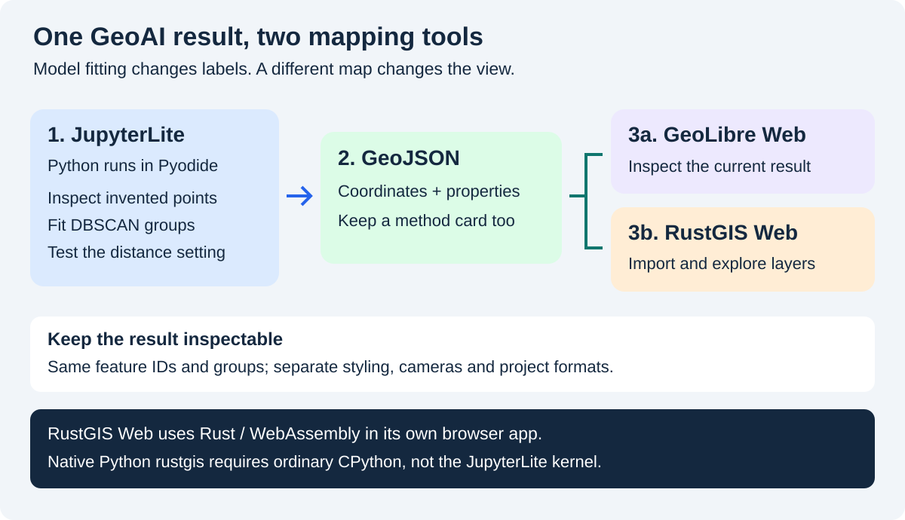

# What is RustGIS?

**RustGIS is a geographic information system for opening, exploring, analyzing and sharing map layers.** It is built in Rust and is available as a desktop application, a command-line tool, a browser app and native Python bindings. This course starts with [RustGIS Web](https://web.rustgis.app/?blank): open a tab and load a small geographic dataset. The browser edition uses WebAssembly; the existence of Python bindings does not mean those bindings run in JupyterLite. [RustGIS source and overview](https://github.com/opengeos/RustGIS/tree/8b322b290448e468c8972df9b1f601d3a72f7d53), [installation guide](https://github.com/opengeos/RustGIS/blob/8b322b290448e468c8972df9b1f601d3a72f7d53/docs/installation.md).

**Try the lesson:** [Read notebook 22](../notebooks/22_rustgis_geoai_bridge.ipynb) · [Run in JupyterLite](https://jltobias.github.io/JupyterLite-GeoLibre-GeoAI/lite/lab/index.html?path=22_rustgis_geoai_bridge.ipynb) · [Watch the captioned walkthrough](https://jltobias.github.io/JupyterLite-GeoLibre-GeoAI/lite/files/assets/learning/22/watch.html).

## Four tools, four roles

| Name | A beginner's description | Role in notebook 22 |
|---|---|---|
| JupyterLite | A notebook workbench running in a browser | Read Python, change a setting and run an experiment |
| GeoAI | AI methods that use geographic context | DBSCAN computes groups using distances between invented locations |
| GeoLibre | An interactive mapping workspace | Optionally inspect the current GeoJSON result with the existing browser adapter |
| RustGIS Web | Another GIS workspace, implemented with Rust/WebAssembly | Import that GeoJSON, inspect its attributes and choose a map view |

Using RustGIS does not by itself make an analysis AI. In this example, **fitting geographic groups is the learning step**. Plotting the result, exporting it or showing it on a globe are separate operations. See [What is GeoAI?](../geoai/primer.md) and [What is GeoLibre?](geolibre.md) for their definitions and credits.



**Read the picture:** the arrow carries coordinates and properties, not a running Python kernel. Each app controls its own view. The original illustration was authored for this lesson; it is not a RustGIS screenshot or an upstream architecture diagram.

## A five-minute exercise: same result, different views

1. Run notebook 22 from the top. Inspect the first point's `id`, coordinates and `synthetic` label. All 20 locations are invented.
2. Fit DBSCAN with 350-meter neighborhoods and a minimum of three points. The example finds two groups of nine and leaves two points unassigned. This describes location density, not health risk.
3. Compare the 150-meter setting: all points become unassigned. Explain why the model setting matters before choosing a view.
4. Run the export cell and download the `.geojson` and provenance `.json` files from `exports`. A file saved inside JupyterLite is not automatically shared with another tab.
5. Open [RustGIS Web with an empty project](https://web.rustgis.app/?blank). Use Add Data or drag the downloaded GeoJSON onto the map. Inspect a feature and compare its group and radius with the notebook. Keep the provenance card beside the data.

For a presentation, open the fixed **published 350-meter example**: [RustGIS 2D view](https://web.rustgis.app/?blank&data=https%3A%2F%2Fjltobias.github.io%2FJupyterLite-GeoLibre-GeoAI%2Flite%2Ffiles%2Fdata%2Frustgis-groups.geojson) · [RustGIS globe view](https://web.rustgis.app/?blank&data=https%3A%2F%2Fjltobias.github.io%2FJupyterLite-GeoLibre-GeoAI%2Flite%2Ffiles%2Fdata%2Frustgis-groups.geojson&projection=globe). These links use RustGIS's documented `blank`, `data` and `projection` URL parameters. They do not upload your notebook edits. Public URL loading depends on the host's CORS policy and network availability; downloading and importing the file provides another transfer route. [Web loading documentation](https://github.com/opengeos/RustGIS/blob/8b322b290448e468c8972df9b1f601d3a72f7d53/docs/installation.md).

**The globe is a view, not a new measurement.** There are no measured heights, disease observations or population denominators in these points. An optional GeoLibre cell displays the same current notebook result. Comparing feature values is more informative than expecting identical styles and cameras.

## Where does the computation happen?

| Route | Runtime | How to start | Boundary |
|---|---|---|---|
| This browser notebook | Python in Pyodide/WebAssembly | Open JupyterLite; run the setup cell | No native `rustgis` installation |
| RustGIS Web | Separate browser app using Rust/WebAssembly | Open the website and load GeoJSON | Hosted assets and optional services can require internet |
| Native RustGIS Python | Ordinary CPython 3.12+ on a supported desktop/server | Follow upstream installation instructions | Native wheels are not Pyodide wheels |

For a later native-Python exercise, upstream documents the following workflow. **Run this only in ordinary CPython with `rustgis` installed, not in JupyterLite:**

```python
import json
from pathlib import Path
import rustgis

features = json.loads(Path("my-rustgis-groups.geojson").read_text(encoding="utf-8"))
session = rustgis.Session()
layer = session.add_geojson(features, name="Invented location groups")
session.zoom_to(layer)
session.save("invented-groups.rgis")
```

The `.rgis` file is a RustGIS project. GeoLibre uses a different project format. **GeoJSON is the shared data contract in this lesson**; project files, styles, chat settings and cameras are not synchronized. Native APIs and supported wheels are documented in [RustGIS Python](https://github.com/opengeos/RustGIS/blob/8b322b290448e468c8972df9b1f601d3a72f7d53/docs/python.md). No native installation is needed to finish the browser lesson.

## Continue with the companion RustGIS course

James L. Tobias's [JupyterLite-RustGIS repository](https://github.com/jltobias/JupyterLite-RustGIS) provided the teaching context for this addition. It offers a separate [Book](https://jltobias.github.io/JupyterLite-RustGIS/book/index.html), [browser Lab](https://jltobias.github.io/JupyterLite-RustGIS/lab/lab/index.html), STAC lessons and a native-Python bridge. Its visual examples include:

| Companion resource | What to inspect | Renderer / interpretation |
|---|---|---|
| [2D map](https://jltobias.github.io/JupyterLite-RustGIS/maps/2d.html) | Features and layer context | MapLibre GL JS companion map |
| [Extruded 3D map](https://jltobias.github.io/JupyterLite-RustGIS/maps/3d.html) | Invented height attributes and perspective | MapLibre GL JS; heights are teaching values |
| [3D scene](https://jltobias.github.io/JupyterLite-RustGIS/maps/scene.html) | Scene geometry and camera changes | Three.js companion scene |

These are linked companion visualizations, not screenshots or renderings produced by this notebook's RustGIS integration. The companion's [data-source register](https://github.com/jltobias/JupyterLite-RustGIS/blob/64ee4e32222c07006ab28a634b759d985a002bda/DATA_SOURCES.md) distinguishes invented geometry, WorldPop STAC footprints and climate tables. A footprint is coverage metadata; it is not a population raster or a population count. Follow the [STAC discovery chapter](stac-discovery.md) before selecting analytical inputs. RustGIS also documents a `stac` URL parameter for Item/Collection handoff; loading a footprint GeoJSON alone does not load the asset's pixels.

## Why this matters for global health

A program team may need to inspect the same analysis in different workspaces. Portable coordinates, stable feature identifiers and a method card make that transfer inspectable. Potential uses include reviewing public facility inventories or exploring geographic groupings before studying service access. They still require verified sites, demand, travel networks, capacity and community knowledge. Notebook 22 demonstrates the transfer and a small fitted model; it does not recommend clinic locations, measure access or estimate disease risk.

**Check your understanding:** would changing from a flat map to a globe improve the model's evidence? No. Evidence changes when inputs, assumptions or validation improve. A clearer view can help people ask better questions about that evidence.

## Sources and attribution

- **RustGIS creators and contributors:** Wu, Q., Rincón Albarracín, J. G., Filho, E., Hofbauer, D., Fitzgerald, M., & Strebel, D. (2026). *RustGIS: A fast, free and open-source GIS in pure Rust for mapping, analyzing and sharing geospatial data.* Zenodo. [doi:10.5281/zenodo.23633281](https://doi.org/10.5281/zenodo.23633281). The upstream repository recommends this citation and uses Apache-2.0. Reviewed source revision: `8b322b290448e468c8972df9b1f601d3a72f7d53`, 2026-10-30. The DOI identifies the software record, not a pinned web deployment.
- **Companion course:** Tobias, James L. *JupyterLite-RustGIS*. [Repository at reviewed revision](https://github.com/jltobias/JupyterLite-RustGIS/tree/64ee4e32222c07006ab28a634b759d985a002bda), accessed 2026-10-30. Its code, graphics and datasets are not copied into this lesson.
- **Clustering:** [scikit-learn DBSCAN documentation](https://scikit-learn.org/stable/modules/generated/sklearn.cluster.DBSCAN.html), including neighborhood distance, minimum samples and the unassigned label.
- **Other software:** [GeoLibre credits](geolibre.md), [JupyterLite introduction](jupyterlite.md), and the Book's [references](../references.md). Underlying data and basemap attribution remains separate from software citation.
