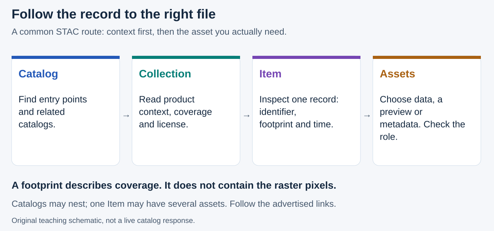
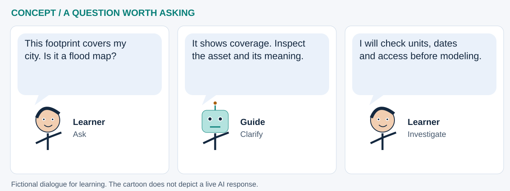

# What is a STAC Browser? Discover data before modeling

**Before asking an AI model a question, ask what the data actually represents.** A STAC Browser helps you inspect geographic datasets through their metadata: descriptions, coverage, dates and links to files. Finding a promising record is a starting point, not proof of data quality or a GeoAI result.

Start with the companion **[JupyterLite STAC Browser Explorer](https://jltobias.github.io/JupyterLite-STAC-Browser/explorer/)**, its [field guide](https://jltobias.github.io/JupyterLite-STAC-Browser/book/), or its [source repository](https://github.com/jltobias/JupyterLite-STAC-Browser). It is a separate project: this chapter connects its discovery workflow to our GeoLibre/GeoAI lessons without embedding another application or copying its client code.

## Read the catalog, not just the map

STAC means **SpatioTemporal Asset Catalog**. The standard describes data in JSON, a structured text format. A browser presents those records for people; a notebook can inspect the same fields programmatically. [STAC specification overview](https://stacspec.org/en/about/stac-spec/).



**Read the picture:** follow the relationships, but check each destination. A thumbnail and an analytical raster can belong to the same Item and serve different purposes. Catalogs can nest, and one Item can link to multiple files; the diagram is a simplified route, not a rigid folder layout.

[Open the full-size discovery diagram](../assets/discovery/stac-route.svg).

| Object | What to look for | Plain-language analogy |
|---|---|---|
| Catalog | Links to other catalogs, collections or Items | A directory |
| Collection | Dataset description, extent, providers and license | A product's information sheet |
| Item | Identifier, geographic footprint, time and asset links | A record for a particular observation or product |
| Asset | File address, media type and declared role | The actual file, a preview, or supporting information |

A **static catalog** can be traversed through links without a remote search service. A **STAC API** may advertise Item Search and other capabilities. Follow its advertised links and conformance; do not append `/search` to every URL or assume every provider accepts the same filters. See the [STAC API Item Search specification](https://github.com/radiantearth/stac-api-spec/blob/main/item-search/README.md).

## A first discovery exercise

Use a public, nonsensitive study area. In the companion Explorer:

1. Connect to **WorldPop** and choose a country collection, such as `UGA`.
2. Draw a small area or use the map extent. Check longitude/latitude order: **west, south, east, north**. Start with a small page of results.
3. Select an Item and inspect its JSON, product description and asset roles. For WorldPop, compare `datetime` with `properties.year` and `properties.project`: release time may differ from the population reference year.
4. Save **Search JSON** and **GeoJSON** together. These describe the completed query and loaded metadata, not all possible matches or downloaded rasters. Save the selected Item separately with **Download item metadata (.json)**.

These controls and export semantics are documented in the companion [exploration guide at revision `563ed59`](https://github.com/jltobias/JupyterLite-STAC-Browser/blob/563ed599a42188a4b476cfec44173e97fa06e3cc/book/exploration.md). Replaying a query later can return changed metadata; keep the original snapshot and retrieval date.

**Check your understanding:** if a footprint covers a district, have you measured its population? **No.** You have found a record whose coverage intersects that district. Reading appropriate raster values, understanding their units and choosing a valid aggregation method are separate steps.

## A metadata passport for every candidate layer

Before including a dataset in an analysis, write down the following. Missing information should remain **unknown**, not become a guessed value.

| Question | Record or verify | Why it matters for GeoAI |
|---|---|---|
| What is measured? | Product, bands, units, scale/offset and NoData | An encoded value, a physical quantity and a display color are different things |
| Where and at what detail? | Footprint, actual valid coverage, raster CRS and resolution | Intersecting coverage does not establish complete or comparable pixels |
| When? | Observation/reference period, release time and version | Mismatched years can produce misleading relationships |
| How reliable? | Quality flags, processing method, uncertainty and known gaps | Models can learn artifacts and sampling differences |
| May I use it? | License, attribution, access rules and redistribution conditions | Discoverability is not permission |
| Can I reproduce it? | Catalog URL, collection/Item IDs, asset key, query, retrieval date and file checksum when downloaded | A model result needs traceable inputs |

Metadata may be distributed across the Collection, Item, extensions and provider documentation. The Item's `geometry` is a geographic footprint; its raster asset can use a different coordinate reference system. `datetime` can also be null when a start/end interval is provided. Inspect declared extensions and the [STAC Item specification](https://github.com/radiantearth/stac-spec/blob/master/item-spec/item-spec.md), rather than treating a missing optional field as zero.

## Read one exported record with Python

Download **one Item's metadata** as `stac-item.json`, upload it beside a notebook in this repository's JupyterLite file browser, and run the following in a new cell. This uses Python's standard library, makes **no network request**, and downloads no asset. Do not substitute Search JSON or a multi-Item GeoJSON export.

```python
import json
from pathlib import Path

item = json.loads(Path("stac-item.json").read_text(encoding="utf-8"))
if not isinstance(item, dict) or item.get("type") != "Feature" or "stac_version" not in item:
    raise ValueError("Use one exported STAC Item, not Search JSON or a FeatureCollection.")

properties = item.get("properties") or {}
assets = item.get("assets") or {}
print("Collection / Item:", item.get("collection", "unknown"), "/", item.get("id"))
print("Time:", properties.get("datetime") or
      (properties.get("start_datetime"), properties.get("end_datetime")))
print("Population year, if advertised:", properties.get("year", "unknown"))
for key, asset in assets.items():
    print(key, "|", asset.get("type", "unknown media type"),
          "| roles:", ", ".join(asset.get("roles") or []) or "not advertised")
if not assets:
    print("No assets advertised in this record; inspect the source documentation.")
```

**Read the code:** `Path` opens your saved text file; `json.loads` turns it into dictionaries. `.get(...)` keeps missing optional fields visible. The loop inspects advertised asset types and roles, not pixel values. These are basic checks for a teaching exercise, **not full STAC schema validation**. Treat the JSON as data, never as Python to execute. No particular output is promised: it depends on your chosen record.

## Search, preview, download and crop are different actions



**Cartoon transcript:** “This footprint covers my city. Is it a flood map?” → “It shows coverage. Inspect the asset and its meaning.” → “I will check units, dates and access before modeling.” This is an original teaching cartoon, not a measured hazard result.

[Open the full-size cartoon](../assets/discovery/stac-cartoon.svg).

Search filters select records; they do not change the files those records describe. The companion now documents whole-asset downloads and a separate, bounded **Clip study bbox → GeoTIFF** action for supported rasters. A polygon's enclosing rectangle is not an exact polygon mask. Protected Copernicus actions have additional requirements and limitations; consult the [current companion README](https://github.com/jltobias/JupyterLite-STAC-Browser/blob/563ed599a42188a4b476cfec44173e97fa06e3cc/README.md) and [provider STAC documentation](https://documentation.dataspace.copernicus.eu/APIs/STAC.html). This chapter adds no download, clipping or authentication implementation to the GeoAI notebooks.

A working catalog page does not prove its asset host accepts notebook requests. Browser CORS rules, HTTPS, authentication, expiring links and service outages can all affect access. A `NetworkError` alone does not identify the cause. Python imports or switching HTTP libraries cannot override the provider's browser policy. Follow provider instructions; do not disable browser security or put credentials in notebook outputs. [Pyodide networking limitations](https://pyodide.org/en/stable/usage/faq.html#how-can-i-load-external-files-in-pyodide).

## Where to explore next

The companion offers multiple presets and a STAC Index directory. These are discovery entry points, not an assurance of access or suitability. The four provider browsers used in our catalog lesson are:

- [WorldPop STAC Browser](https://stac.worldpop.org/): inspect population product definitions and reference years.
- [Copernicus STAC Browser](https://browser.stac.dataspace.copernicus.eu/): inspect Earth-observation products, bands and processing levels.
- [USGS LandsatLook STAC Browser](https://landsatlook.usgs.gov/stac-browser/): inspect Landsat records and asset choices.
- [UN Biodiversity Lab STAC Browser](https://stac.unbiodiversitylab.org/): inspect available environmental layers and their individual metadata and terms.

| Continue in this repository | What the notebook demonstrates | What not to infer |
|---|---|---|
| [Lab 07: catalog discovery](../notebooks/07_stac_browser_catalogs.ipynb) | Browser links and a schematic relationship graph; direct API probing is intentionally skipped in JupyterLite | That every provider API has been queried successfully |
| [Lab 08: metadata to features](../notebooks/08_stac_geoai_footprints.ipynb) | Search results, metadata-derived features, clustering and footprint display when data are available | That metadata clusters classify image content or disease risk |
| [Lab 11: wildfire triage](../notebooks/11_wildfire_stac_triage.ipynb) | A candidate-event workflow connected to imagery discovery | That an intersecting image establishes damage or causation |

**Potential global-health benefit:** a team could use discovery to assemble candidate population and environmental inputs for a service-access or climate–health question. The passport exposes incompatible years, units and coverage **before** model fitting. STAC supplies discovery and provenance, not clinical evidence. Population estimates are not HIV/TB prevalence; vegetation is not a malaria diagnosis; a flood footprint alone is not a service-disruption estimate. These are proposed uses requiring domain review, validation and appropriate governance. See [HIV/TB planning](../geoai/hiv-tb.md), [climate–health](../geoai/climate-health.md) and [map privacy](../futures/map-encryption.md).

## Sources and attribution

- **Companion software:** *JupyterLite STAC Browser: STAC Field Guide*, **JupyterLite-STAC-Browser contributors**, as named in its [CITATION.cff](https://github.com/jltobias/JupyterLite-STAC-Browser/blob/563ed599a42188a4b476cfec44173e97fa06e3cc/CITATION.cff). Reviewed revision `563ed599a42188a4b476cfec44173e97fa06e3cc`, 11 October 2026. Its MIT software license does not replace dataset terms.
- **Standards and upstream tools:** [STAC community](https://stacspec.org/en/about/stac-spec/), [STAC API contributors](https://github.com/radiantearth/stac-api-spec), and the distinct [STAC Browser project maintained in `radiantearth/stac-browser`](https://github.com/radiantearth/stac-browser). Do not conflate the standard, that upstream browser and Tobias's companion repository. [GeoLibre](geolibre.md) is the separate visualization project by Qiusheng Wu and contributors.
- **Figures:** two original SVG teaching illustrations generated by `scripts/build_stac_discovery.py`. They are not screenshots of a provider response or copied dataset imagery. Provider data, basemaps and third-party software retain their own credits and terms.

**Try it:** compare two candidate layers using the passport, record one reason to reject a layer, and identify which missing fact you would resolve before running a model.
